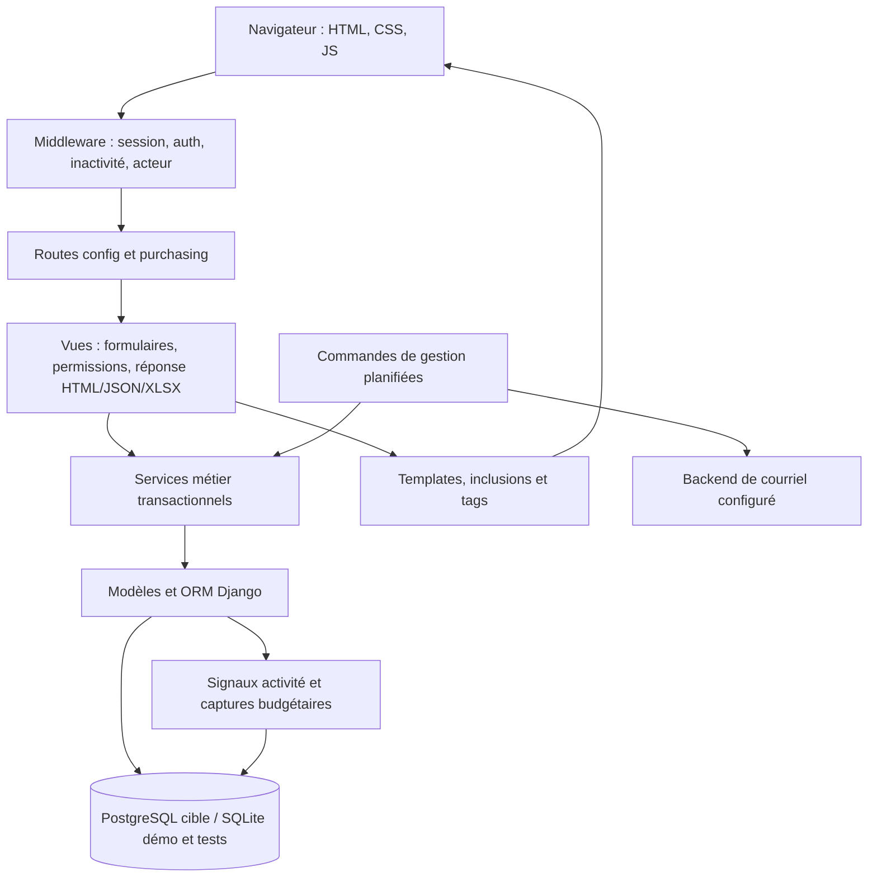
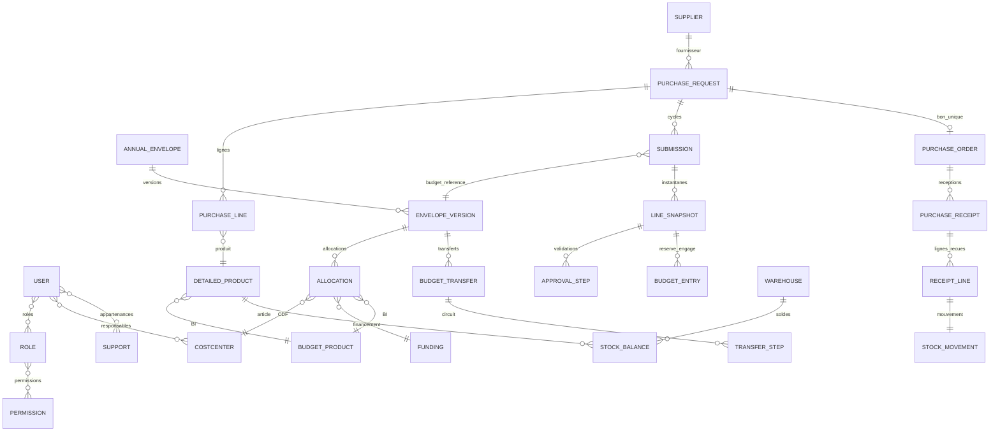

# ERP — Documentation technique, architecture et performances

État de référence : 14 novembre 2026, base Git `dc67883` et modifications locales.
Ce document distingue le comportement constaté, les mesures locales et les
améliorations proposées. Il ne décrit pas un déploiement de production vérifié.

Voir aussi [fonctionnel](DOCUMENTATION_FONCTIONNELLE.md),
[recette](PLAN_TESTS.md) et [classeur exécutable par un testeur](PLAN_TESTS.xlsx).
Les annexes de schéma, routes, code et tests sont extraites du code courant.

## 1. Architecture générale

Monolithe Django, rendu serveur HTML, JavaScript natif pour les interactions
et CSS partagé. Pas de SPA, API REST générale, React, TypeScript, broker ou
worker Celery présent. Les points JSON existants sont spécialisés : statut
de session, décisions de DA et résultats d'import ; d'autres recherches
renvoient des fragments HTML AJAX.



La séparation principale est vue/formulaire/service/modèle. Les vues traitent
les méthodes HTTP, les droits, la validation de saisie et la présentation.
Les services portent les transactions, verrous, règles, révisions et audits.
Les contraintes SQL et triggers PostgreSQL complètent les contrôles Python.
Un accès direct au modèle ne doit pas devenir l'API métier de mutation.

## 2. Socle et dépendances

| Dépendance figée | Usage |
| --- | --- |
| Django 5.2.15 | ORM, auth, sessions, formulaires, templates, administration, tests |
| asgiref 3.11.1 | Infrastructure sync/async requise par Django |
| sqlparse 0.5.5 | Dépendance SQL de Django |
| psycopg 3.3.4 + psycopg-binary 3.3.4 | Pilote PostgreSQL et implémentation binaire |
| typing_extensions 4.15.0 | Compatibilité de typage, notamment pilote selon Python |
| tzdata 2026.2 | Base de fuseaux, notamment sous Windows |
| python-dotenv 1.2.2 | Chargement local des variables d'environnement |
| openpyxl 3.1.5 | Lecture/écriture XLSX ; dépendance transitive et-xmlfile |

`requirements.txt` fige ces neuf distributions ; il ne s'agit pas d'un
lockfile exhaustif avec hashes de tous les transitifs. L'environnement
mesuré utilise Python 3.12 ; les chiffres précis figurent dans les mesures.

## 3. Organisation du code

| Répertoire / fichier | Responsabilité |
| --- | --- |
| `manage.py`, `config/asgi.py`, `config/wsgi.py` | Entrées commandes, ASGI et WSGI |
| `config/settings.py` | Apps, middlewares, backend auth, DB, langue, statiques et courriels |
| `config/demo_settings.py` | Base SQLite persistante de démonstration |
| `config/test_settings.py` | SQLite mémoire et hasher rapide pour tests isolés |
| `config/postgresql_test_settings.py` | Acceptation PostgreSQL via variables TEST_PG_* |
| `config/excel.py` | Export XLSX générique, dates, nombres, texte et en-têtes HTTP |
| `accounts/models.py`, `backends.py` | Utilisateurs, rôles, habilitations historiques, union des permissions |
| `accounts/middleware.py`, `auth_views.py`, `forms.py` | Inactivité, connexion et validation des accès |
| `accounts/services.py` | Publication immuable et recherche d'habilitations historiques |
| `accounts/admin_deletion.py` | Aperçu du graphe de suppression et maintenance superutilisateur |
| `accounts/permission_labels.py` | Libellés français des permissions, raccordement post_migrate |
| `suppliers/models.py`, `forms.py`, `views.py` | Référentiels fournisseur, contacts/adresses et écrans applicatifs |
| `purchasing/models.py` | DA, compteur annuel, lignes, réexportation de modèles de circuit |
| `purchasing/flow_models.py` | Enveloppes, versions, allocations, soumissions, snapshots, étapes, commandes et notifications |
| `purchasing/services.py` | Création/édition/annulation de DA et lignes, audit/révision |
| `purchasing/flow.py` | Disponible, réservation, décisions, avancement, bon, délégations et notifications |
| `purchasing/views.py`, `flow_views.py` | Écrans DA, actions, boîte personnelle, consultation et impression |
| `purchasing/budget_views.py` | Versions, alimentation, consultation, configuration et référentiels produits |
| `purchasing/allocation_excel.py` | Contrôles XLSX et import transactionnel des allocations |
| `purchasing/rule_views.py` | GET de compatibilité vers Configuration et POST 410 de l'ancien éditeur |
| `purchasing/context_processors.py` | Navigation, permissions de rubriques et badge des tâches |
| `purchasing/templatetags` | Retour contextuel, formats de montants et groupes d'administration |
| `budgeting/models.py`, `forms.py`, `views.py` | CDF, supports, financements, BI, responsables et modèles/proxies |
| `budgeting/transfers.py` | Transferts, décisions, groupes, soldes et audit |
| `budgeting/transfer_views.py` | Formsets, destination commune, filtrage et actions groupées signées |
| `budgeting/history.py` | Captures datées des états budgétaires et description des changements |
| `receiving/services.py` | Entrée/sortie/transfert/inventaire de stock et idempotence |
| `receiving/purchases.py` | Réception de commande et calcul des quantités reçues/restantes |
| `receiving/views.py` | Écrans de stock, dépôts et réceptions, exports opérationnels |
| `workflow/activity.py`, `models.py` | Acteur courant, signaux et journal indépendant des identités/objets |
| `templates/admin` | Surcharges chargées implicitement par Django |
| `tools/mesurer_performances.py` | Mesures isolées reproductibles, jamais sur une base métier |
| `tools/executer_tests_documentes.py` | Exécution réelle de la suite isolée et verdict individuel JSON |
| `tools/actualiser_documentation.py` | Cas de recette, classeur, schéma, routes et index de code générés |

Les modèles de budget exposés dans `budgeting` et `purchasing` ne correspondent
pas tous à des tables distinctes. Les proxies réutilisent les mêmes tables
avec des droits et une administration adaptés. Ne pas supprimer leurs imports
sous prétexte qu'ils semblent inutilisés dans un fichier.

## 4. Architecture de données



Le diagramme donne les relations métier principales. L'annexe de chaque
modèle fait autorité sur les champs, types, nullabilité, FK et unicités.
Les cardinalités exactes peuvent aussi dépendre d'une contrainte unique ou
conditionnelle ; consulter celle-ci avant toute requête de maintenance.

### 4.1 Identités et référentiels

`User` étend AbstractUser. Les permissions natives utilisateur/groupe sont
complétées par les rôles ERP via RolePermissionBackend. Les affectations CDF,
supports et appartenances sont des relations M2M distinctes. Les contacts et
adresses fournisseurs protègent leur fournisseur par FK.

### 4.2 Versionnement et calcul budgétaire

Une enveloppe annuelle référence une version active ; ses versions portent
les allocations. Les réservations et engagements de DA sont interprétés au
niveau annuel, tandis que les transferts sont isolés par version. Les
snapshots gardent les valeurs et références utilisées par la soumission.

Les allocations et montants de snapshots utilisent les décimales du modèle,
pas des floats. `Decimal` et les limites de précision sont nécessaires à
l'exactitude ; l'arrondi de présentation n'est pas un arrondi d'écriture.
Les opérations intermédiaires de DA peuvent produire plus de deux décimales.

### 4.3 Snapshots et journal

`Submission` conserve le fournisseur sérialisé et la version de budget.
`LineSnapshot` conserve les données de ligne et ses dimensions au moment
de la soumission. `PurchaseOrder` référence la soumission approuvée ; modifier
les référentiels ensuite ne doit pas réécrire le bon.

`AuditEvent` impose l'unicité demande/révision. `ConfigurationAuditEvent`
trace d'autres commandes. `ActivityLog` stocke les identités et références
sous forme de valeurs, sans FK vers les personnes/objets supprimables.
`BudgetHistoryEvent` conserve un état JSON daté de l'enveloppe et de ses
versions ; il ne constitue pas uniquement une liste de deltas.

## 5. Contrats transactionnels

### 5.1 DA : création, modification et numéro

`create_purchase_request` vérifie l'acteur et le support puis crée la DA,
incrémente sa révision et écrit son audit dans une transaction. Les commandes
d'édition verrouillent la DA et exigent `expected_revision` et la propriété
de la demande. Un conflit est distinct d'une erreur de validation.

Le compteur `PurchaseRequestSequence` possède une ligne par année. Le numéro
est affecté à la sauvegarde initiale, sous verrou et transaction, au format
DA-AAAA-NNNN. Instancier un formulaire sans sauvegarde ne consomme pas un
numéro. Les références explicites/historiques sont conservées.

### 5.2 Soumission et validation

Ordre de verrouillage principal : demande → enveloppe annuelle → étapes.
Le budget est vérifié sur les lignes agrégées par combinaison. Création de
la soumission, snapshots, écritures réservées et étapes doit réussir ensemble.
Une insuffisance annule l'ensemble.

`_advance` actualise les affectations et suit l'ordre des étapes d'une ligne.
Les lignes sont parallèles. Les nouvelles soumissions ne créent qu'une étape
responsable CDF par ligne ; les branches de fonctions/rôles/règles historiques
restent nécessaires aux cycles déjà enregistrés.

`decide` relit l'état et le droit. Approbation, correction et rejet ont des
effets différents. Le droit admin n'autorise pas à rendre arbitrairement une
étape future courante ; l'action globale fait avancer le circuit dans l'ordre.
Toutes les lignes approuvées déclenchent `_finish`, le bon unique et la
conversion réservé → engagé. `_stop` libère les réservations et clôt le cycle.

### 5.3 Transferts

`act` verrouille transaction, enveloppe et version puis vérifie révision,
droits et admissibilité. Les étapes fixes sont source puis destination.
Le solde est calculé par version et état : débit source en attente, crédit
destination à l'approbation. Les opérations globales utilisent les révisions
de toutes les lignes et une transaction commune ; une erreur annule tout.

Le snapshot signé HTTP limite les décisions depuis une liste périmée. Il ne
remplace ni l'autorisation serveur ni les contrôles de révision/état.

### 5.4 Stock et réception

`move` verrouille les dépôts dans un ordre stable, y compris quand le solde
n'existe pas encore. Le token unique est relu avant mutation ; un replay
identique retourne l'opération existante et un replay contradictoire échoue.
La contrainte quantité non négative complète le contrôle applicatif.

`receive_purchase` exige une DA commandée, vérifie les quantités figées et
déjà reçues, puis crée réception, lignes et mouvements dans une transaction.
Les tokens des mouvements dérivent du token de réception et de la ligne.
Les achats reçus et mouvements libres restent deux notions distinctes.

## 6. HTTP, frontend et échanges

Les vues sont décorées par login_required, permission_required et/ou
require_http_methods. La matrice exacte des routes figure en annexe.
Un GET de compatibilité peut rediriger et un POST d'éditeur retiré répondre
410 ; ces routes ne sont pas un nouveau système de configuration.

| Interface | Contrat |
| --- | --- |
| Statut session | GET, JSON `authenticated`, cache no-store ; ne prolonge pas l'activité |
| Soumission/décision DA | POST avec CSRF et expected_revision ; `Accept: application/json` pour popup, destination ou liste d'erreurs |
| Recherches produits/allocations | GET avec q, en-tête X-Requested-With ; fragment HTML et maintien des filtres |
| Import allocations | Multipart avec CSRF ; validation serveur puis JSON selon mode AJAX ; aucune écriture partielle |
| Export Excel | Requête `export=xlsx`, portée et permissions de la vue ; réponse XLSX privée/no-store |
| Bon de commande | GET protégé, SAMEORIGIN pour impression dans iframe de même origine |

Le JS d'actions de DA intercepte le clic d'impression et charge le document
hors écran avant `print()`. La présence du marqueur du document est vérifiée.
Les messages d'erreur sont insérés avec textContent. Les recherches AJAX
annulent les requêtes obsolètes et protègent les modifications non enregistrées.
Le thème utilise stockage local, préférence système et messages de même
origine ; le stockage indisponible ne doit pas bloquer l'interface.

### Fichiers navigateur

| Fichier | Rôle |
| --- | --- |
| `theme.js` | Thème clair/sombre, onglets, iframe et préférence système |
| `purchase_actions.js` | Soumission, décisions, confirmations, erreurs et impression |
| `allocation_search.js` | Recherche/pagination AJAX et protection des saisies en cours |
| `budget_allocations.js` | Chargement des références, suppression visuelle et annulation avant sauvegarde |
| `budget_products.js` | Recherche de BI avec temporisation et requête annulable |
| `allocation_import.js` | Envoi du fichier, progression et résultat serveur |
| `budgeting/transfer_lines.js` | Formset dynamique et total de destination |
| `budgeting/transfer_actions.js` | Confirmation et motif des actions de transfert |

`erp.css` porte le shell et les variables de thème ; `configuration.css`
les sections, tables et frises ; `actions.css` les icônes, groupes et fenêtres.
Les autres feuilles couvrent administration, import et schémas explicatifs.

## 7. Sécurité et limites constatées

- Autorisation métier côté serveur, contrôle CSRF des mutations, échappement
  des templates et séparation des profils financiers/opérationnels.
- Union des permissions avec cache sur l'instance utilisateur : pour observer
  un changement de droits dans un script/test, relire une instance fraîche.
- Expiration d'inactivité avant vue, y compris administration et POST.
- Les exports texte ne doivent pas devenir des formules Excel. Les imports
  refusent formules/erreurs et limitent tailles compressée/décompressée.
- Immutabilité Python et protections PostgreSQL ne sont pas équivalentes :
  des opérations QuerySet contournent `save`; les triggers sont indispensables
  aux garanties SQL qu'ils implémentent.
- Le journal exclut notamment mot de passe et dernière connexion de ses
  captures. Vérifier la minimisation et rétention selon le contexte réel.
- La maintenance de suppression nécessite superutilisateur actif, aperçu,
  verrouillage, journal et configuration transactionnelle des guards.
- Les réglages fournis contiennent DEBUG activé et une clé de développement
  statique ; ils ne constituent pas une configuration de production validée.
  ALLOWED_HOSTS, secrets, TLS/cookies, serveur applicatif, proxy, sauvegardes
  et supervision doivent être traités par l'exploitation avant exposition.
- Aucun test de pénétration, revue complète des configurations de déploiement
  ou certification de conformité n'a été réalisé dans cette mission.

## 8. Installation, tests et exploitation

Exemples PowerShell depuis la racine. Employer un environnement isolé.

```powershell
python -m venv .venv
.venv\Scripts\python.exe -m pip install -r requirements.txt
.venv\Scripts\python.exe manage.py check --settings=config.demo_settings
.venv\Scripts\python.exe manage.py migrate --settings=config.demo_settings
.venv\Scripts\python.exe manage.py createsuperuser --settings=config.demo_settings
.venv\Scripts\python.exe manage.py runserver --settings=config.demo_settings
```

`demarrer-recette.cmd` applique les migrations de démonstration puis lance
le serveur local. Pour la recette, utiliser une copie/installation jetable,
pas une base contenant les seules données métier disponibles. La commande
`seed_purchase_demo --settings=config.demo_settings` est limitée à la démo,
réexécutable, et ne réinitialise pas les mots de passe existants. Le jeu QA
précis du plan de tests se configure séparément.

PostgreSQL normal : DB_NAME, DB_USER, DB_PASSWORD, DB_HOST, DB_PORT.
Tests PostgreSQL : TEST_PG_DATABASE, TEST_PG_USER, TEST_PG_PASSWORD,
TEST_PG_HOST et TEST_PG_PORT. Utiliser un rôle pouvant créer une base de tests.
Ne pas confondre ces deux jeux de paramètres.

Courriels : EMAIL_BACKEND, EMAIL_HOST, EMAIL_PORT, EMAIL_HOST_USER,
EMAIL_HOST_PASSWORD, EMAIL_USE_TLS, DEFAULT_FROM_EMAIL, ERP_BASE_URL,
PURCHASE_EMAIL_MAX_ATTEMPTS et PURCHASE_EMAIL_RETRY_SECONDS.
Le backend par défaut écrit en console ; ce n'est pas un envoi SMTP réel.

```powershell
.venv\Scripts\python.exe manage.py test --settings=config.test_settings --noinput
.venv\Scripts\python.exe manage.py test --settings=config.postgresql_test_settings --noinput
.venv\Scripts\python.exe manage.py makemigrations --check --dry-run --settings=config.test_settings
.venv\Scripts\python.exe manage.py process_purchase_notifications --settings=config.demo_settings --limit 100
.venv\Scripts\python.exe manage.py initialize_budget_history --settings=config.demo_settings
```

Planifier les notifications via l'ordonnanceur d'exploitation ; aucun service
de planification permanent n'est installé par ce dépôt. `--recover` réexamine
les échecs permanents. Ne pas exécuter une commande sur une base cible sans
vérifier son module de settings. Les sauvegardes SQLite ne sont pas versionnées.
Pour PostgreSQL, définir puis éprouver sauvegarde/restauration cohérente,
objectif de perte admissible et délai de reprise ; aucun objectif n'est
actuellement contractualisé dans le code.

## 9. Migrations et compatibilité

Conserver toutes les migrations historiques et leurs fonctions référencées.
Les migrations créent aussi des contraintes et guards PostgreSQL : une simple
création des tables ORM ne reconstruit pas nécessairement leurs protections.
Le moteur SQLite n'émule pas les verrous de lignes et contraintes d'exclusion.

Des versions de workflow, règles et habilitations demeurent pour les données
antérieures, bien que l'éditeur de règles soit retiré. Ne pas interpréter leur
présence comme la possibilité de configurer le circuit des nouvelles DA.
Une suppression de colonne/table ou migration de données demanderait une
analyse distincte ; aucun retrait de données n'est demandé par ces documents.

## 10. Analyse des performances : protocole et interprétation

Les mesures ci-après proviennent de `tools/mesurer_performances.py`.
La base est créée en mémoire avec config.test_settings, migrée puis détruite.
Les données sont synthétiques et ne proviennent pas de la base de démonstration.
Une requête de chauffe précède trois répétitions par couple écran/volume.
Sont mesurés : durée Python/serveur par perf_counter, nombre de requêtes SQL,
taille de réponse et pic de mémoire Python tracée par tracemalloc.

Ce protocole inclut le middleware, le contexte et le rendu Django mais exclut
réseau, TLS, disque PostgreSQL, temps du navigateur et utilisateurs concurrents.
Le traçage SQL et mémoire ajoute un coût. Trois répétitions ne permettent pas
de publier un p95/p99 crédible. La médiane locale n'est pas un SLA de production.
Les compteurs SQL sont réinitialisés et leur capacité est augmentée pour
éviter une troncature à 9 000 requêtes.

```powershell
.venv\Scripts\python.exe tools/mesurer_performances.py --output docs/mesures_performances.json --repetitions 3
```

### Risques déduits du code, distincts des mesures

| Zone | Risque | Action proposée et validation attendue |
| --- | --- | --- |
| `flow_views.budgets` | Requêtes par combinaison, appels répétés à available et transfert_balance | Préagréger allocations/écritures/transferts par clés ; vérifier égalité exacte des soldes et baisse du nombre SQL |
| `context_processors.navigation` | Actualisation de tous les transferts en attente et comptage au rendu de nombreuses pages | Mesurer avec 10/100/1 000 transferts actifs ; éviter l'actualisation globale répétée sans perdre la fraîcheur des droits |
| `pending_validation_count` | Rafraîchissements et vérification d'autorité par étape | Mesurer par nombre de soumissions actives et délégations ; conserver contrôles de révocation |
| `budgeting.history.capture` | Sérialisation complète des versions et combinaisons à chaque capture | Mesurer temps et taille JSON sur 10 000 allocations et plusieurs versions ; proposer rétention/architecture avec conservation des états historiques |
| `_advance` | Requêtes de candidats/habilitations par étape ; certains GET actualisent l'état | Profiler nombre d'étapes ouvertes et actualisations répétées ; garder transaction et révisions correctes |
| Liste fournisseurs, DA et disponibilités | Certaines listes non paginées ; HTML et calculs croissants | Mesurer 1 000/10 000 objets puis ajouter pagination/filtrage sans modifier portée ni exports |
| Formulaires allocations | Pagination à 25 lignes mais listes de références transmises au navigateur | Mesurer octets et mémoire quand les référentiels augmentent ; conserver choix actuels et recherche |
| Import XLSX | Lecture/parsing + contraintes + audit/historique dans un lot | Mesurer 1 000 et 10 000 lignes, invalidité en dernière ligne et annulation intégrale |
| Transactions annuelles et dépôts | Verrous volontairement larges pour éviter surconsommation/stock négatif | Mesurer contention PostgreSQL, deadlocks et attente ; ne pas supprimer les verrous pour gagner du temps |
| Courriels | Envoi réalisé lors du traitement durable, dans une transaction par notification | Mesurer latence SMTP, timeouts et taille de file ; conserver tentatives et absence d'effet sur les décisions métier |

Ces propositions ne sont pas implémentées par la rédaction documentaire.
Un index ne doit être ajouté qu'après plan EXPLAIN/ANALYZE sur un volume
représentatif : pas de gain garanti par sa seule présence.

### Campagne de performance de cible à conduire

Sur une instance PostgreSQL dédiée, définir machine/versions/données, puis
exécuter lecture, import, décision et réception à 1, 10, 25 puis 50 sessions.
Après chauffe, recueillir au moins plusieurs centaines d'échantillons par
route, p50/p95/p99, taux d'erreur, débit, CPU, RSS, connexions, SQL et attentes
de verrous. Capturer aussi temps navigateur et octets réseau pour les grandes
pages. Séparer caches froid/chaud, lecture/écriture et données historiques.

Critères initiaux proposés, à approuver avant qualification : pas de solde
incohérent ni double commande/réception ; pas d'erreur serveur sur le palier
retenu ; cible p95 de lecture à fixer avec le métier ; pour un import, durée
et progression mesurées, rejet atomique garanti. Les seuils chiffrés de débit
ou SLA ne sont pas inventés à partir de SQLite.

## 11. Maintenance et diagnostic

Pour une erreur : relever route, heure/fuseau, acteur, DA/transfert, révision,
statut HTTP et corrélation avec AuditEvent/ConfigurationAuditEvent/ActivityLog.
Pour un budget : reconstituer version, année, combinaison, allocations,
réservations, engagements, transferts source/destination et état daté.
Pour le stock : dépôt/produit, token, mouvements, réception et total livré.

### Archivage de l’historique budgétaire

Dans **Administration → Budgets → Archivage de l’historique budgétaire**,
un superutilisateur peut exporter les événements antérieurs à une date
limite, éventuellement pour un exercice budgétaire précis. Le téléchargement
produit un fichier JSON compressé `.json.gz` qui contient les états et les
informations d’audit de la période.

Conserver le fichier d’origine dans le stockage d’archives prévu pour les
données budgétaires. Recharger ce même fichier, puis confirmer le retrait
dans le formulaire de purge. L’application vérifie l’empreinte par rapport
à l’export journalisé et vérifie que les événements correspondent encore
au fichier. Le dernier état exporté de chaque exercice reste consultable
et sert de référence pour les mouvements suivants. Les événements retirés
se consultent dans le fichier d’archive. Les journaux d’audit existants
sont conservés. Les opérations d’export et de purge y sont tracées.

Avant une modification : exécuter les tests du module, la suite complète,
les tests PostgreSQL applicables, la compilation des templates/scripts et
la recette navigateur touchée. Pour une migration, tester installation vide
et montée de version sur copie représentative, avec restauration éprouvée.
Ne pas masquer un test ignoré ou une dépendance manquante comme un succès.

Les annexes suivantes détaillent le schéma réel, les routes et les symboles
du code. Elles sont un instantané à mettre à jour lors des évolutions.


<!-- ANNEXES AUTO : tools/actualiser_documentation.py -->

## Résultats de performance mesurés

Mesure horodatée : `2026-11-14T22:21:36.734128+00:00`. Python `3.12.10`, Django `5.2.15`, `Windows-11-10.0.26200-SP0`. Moteur : SQLite in memory.

| Scénario | Volume | Médiane ms | Min–max ms | SQL min–max | Réponse octets | Pic Python Mio |
| --- | ---: | ---: | --- | --- | ---: | ---: |
| allocation_version_page | 10 | 196.08 | 195.6–198.95 | 23–23 | 29227 | 1.96 |
| budget_balances_page | 10 | 186.38 | 184.75–186.64 | 111–111 | 9993 | 0.59 |
| allocation_version_page | 100 | 380.9 | 372.1–407.73 | 23–23 | 49894 | 3.72 |
| budget_balances_page | 100 | 1489.21 | 1482.51–1495.73 | 921–921 | 24213 | 1.45 |
| allocation_version_page | 1000 | 412.49 | 409.62–437.21 | 23–23 | 89499 | 4.08 |
| budget_balances_page | 1000 | 15219.1 | 14872.47–15476.48 | 9021–9021 | 167313 | 10.61 |
| purchase_detail_page | 1 | 58.44 | 57.87–59.11 | 26–26 | 13110 | 0.46 |
| purchase_detail_page | 10 | 80.04 | 79.63–80.19 | 26–26 | 25568 | 0.52 |
| purchase_detail_page | 50 | 176.39 | 175.98–177.78 | 26–26 | 81049 | 0.88 |

Interprétation : la page des disponibilités passe de 111 requêtes SQL pour 10 combinaisons à 921 pour 100 puis 9 021 pour 1 000, soit `9 × N + 21` sur ce jeu. Le coût des requêtes par combinaison est donc démontré. La page d'allocations paginée reste à 23 requêtes pour 10/100/1 000 allocations ; le détail d'une DA brouillon reste à 26 requêtes pour 1/10/50 lignes, mais temps et réponse croissent avec le contenu. Ces résultats ne couvrent pas les frises actives ni de nombreux transferts en attente.

Priorité proposée : préagrégation du tableau des disponibilités et recette d'équivalence des soldes, puis mesure des rafraîchissements de tâches et des captures historiques sur PostgreSQL. Le scénario à 1 000 combinaisons est un signal de risque de latence ; aucune extrapolation de débit de production n'est légitime à partir de ces trois répétitions instrumentées.


## Annexe A — Dictionnaire des données exhaustif

Extraction des modèles métier enregistrés par Django. Les tables auth, sessions, admin et contenttypes sont fournies par Django ; leurs migrations restent requises. `null` concerne SQL ; `blank` concerne la validation de saisie. Les tables M2M automatiques ne sont pas de nouveaux modèles métier.

50 modèles métier enregistrés, dont 5 proxies ; 45 tables concrètes métier distinctes, hors tables M2M automatiques.


### accounts.SessionPolicy

Table : `accounts_sessionpolicy`. Proxy : non. Ordre : `[]`.

| Champ | Libellé | Type / format | Null | Vide | Relation / suppression | Unicité / index | Défaut / validateurs |
| --- | --- | --- | --- | --- | --- | --- | --- |
| id | ID | BigAutoField  | False | True |  | PK, UNIQUE | MinValueValidator(-9223372036854775808); MaxValueValidator(9223372036854775807) |
| idle_timeout_minutes | Déconnexion après inactivité (minutes) | PositiveIntegerField  | False | False |  |  | défaut=120; MinValueValidator(1); MaxValueValidator(10080) |

Contraintes :
- `<CheckConstraint: condition=(AND: ('idle_timeout_minutes__gte', 1), ('idle_timeout_minutes__lte', 10080)) name='session_timeout_valid_range'>`

### accounts.Role

Table : `accounts_role`. Proxy : non. Ordre : `[]`.

| Champ | Libellé | Type / format | Null | Vide | Relation / suppression | Unicité / index | Défaut / validateurs |
| --- | --- | --- | --- | --- | --- | --- | --- |
| id | ID | BigAutoField  | False | True |  | PK, UNIQUE | MinValueValidator(-9223372036854775808); MaxValueValidator(9223372036854775807) |
| code | Code | CharField max_length=50 | False | False |  | UNIQUE | MaxLengthValidator(50) |
| label | Libellé | CharField max_length=100 | False | False |  |  | MaxLengthValidator(100) |
| permissions | Permissions | ManyToManyField  | False | True | auth.Permission |  |  |

Tables de liaison automatiques :
- `accounts_role_permissions` pour `permissions`.

### accounts.User

Table : `accounts_user`. Proxy : non. Ordre : `[]`.

| Champ | Libellé | Type / format | Null | Vide | Relation / suppression | Unicité / index | Défaut / validateurs |
| --- | --- | --- | --- | --- | --- | --- | --- |
| id | ID | BigAutoField  | False | True |  | PK, UNIQUE | MinValueValidator(-9223372036854775808); MaxValueValidator(9223372036854775807) |
| password | mot de passe | CharField max_length=128 | False | False |  |  | MaxLengthValidator(128) |
| last_login | dernière connexion | DateTimeField  | True | True |  |  |  |
| is_superuser | statut super-utilisateur | BooleanField  | False | False |  |  | défaut=False |
| username | nom d’utilisateur | CharField max_length=150 | False | False |  | UNIQUE | UnicodeUsernameValidator; MaxLengthValidator(150) |
| first_name | prénom | CharField max_length=150 | False | True |  |  | MaxLengthValidator(150) |
| last_name | nom | CharField max_length=150 | False | True |  |  | MaxLengthValidator(150) |
| email | adresse électronique | EmailField max_length=254 | False | True |  |  | EmailValidator; MaxLengthValidator(254) |
| is_staff | statut équipe | BooleanField  | False | False |  |  | défaut=False |
| is_active | actif | BooleanField  | False | False |  |  | défaut=True |
| date_joined | date d’inscription | DateTimeField  | False | False |  |  | défaut=django.utils.timezone.now |
| groups | groupes | ManyToManyField  | False | True | auth.Group |  |  |
| user_permissions | permissions de l’utilisateur | ManyToManyField  | False | True | auth.Permission |  |  |
| supports | Supports d’appartenance | ManyToManyField  | False | True | budgeting.Support |  |  |
| roles | Rôles ERP | ManyToManyField  | False | True | accounts.Role |  |  |

Tables de liaison automatiques :
- `accounts_user_groups` pour `groups`.
- `accounts_user_user_permissions` pour `user_permissions`.
- `accounts_user_supports` pour `supports`.
- `accounts_user_roles` pour `roles`.

### accounts.ValidationFunction

Table : `accounts_validationfunction`. Proxy : non. Ordre : `['position', 'pk']`.

| Champ | Libellé | Type / format | Null | Vide | Relation / suppression | Unicité / index | Défaut / validateurs |
| --- | --- | --- | --- | --- | --- | --- | --- |
| id | ID | BigAutoField  | False | True |  | PK, UNIQUE | MinValueValidator(-9223372036854775808); MaxValueValidator(9223372036854775807) |
| code | Code | CharField max_length=50 | False | False |  | UNIQUE | MaxLengthValidator(50) |
| label | Libellé | CharField max_length=100 | False | False |  |  | MaxLengthValidator(100) |
| position | Position | PositiveIntegerField  | False | False |  | UNIQUE | MinValueValidator(0); MaxValueValidator(9223372036854775807) |

### accounts.Authorization

Table : `accounts_authorization`. Proxy : non. Ordre : `[]`.

| Champ | Libellé | Type / format | Null | Vide | Relation / suppression | Unicité / index | Défaut / validateurs |
| --- | --- | --- | --- | --- | --- | --- | --- |
| id | ID | BigAutoField  | False | True |  | PK, UNIQUE | MinValueValidator(-9223372036854775808); MaxValueValidator(9223372036854775807) |
| user | Utilisateur | ForeignKey  | True | True | accounts.User / SET_NULL | INDEX |  |
| function | Fonction de validation | ForeignKey  | False | False | accounts.ValidationFunction / PROTECT | INDEX |  |
| current_version | Version courante | ForeignKey  | True | True | accounts.AuthorizationVersion / PROTECT | INDEX |  |

Permissions métier :
- `accounts.manage_authorizations` : Gérer les habilitations versionnées

### accounts.AuthorizationVersion

Table : `accounts_authorizationversion`. Proxy : non. Ordre : `[]`.

| Champ | Libellé | Type / format | Null | Vide | Relation / suppression | Unicité / index | Défaut / validateurs |
| --- | --- | --- | --- | --- | --- | --- | --- |
| id | ID | BigAutoField  | False | True |  | PK, UNIQUE | MinValueValidator(-9223372036854775808); MaxValueValidator(9223372036854775807) |
| authorization | Habilitation | ForeignKey  | False | False | accounts.Authorization / PROTECT | INDEX |  |
| version | Version | PositiveIntegerField  | False | False |  |  | MinValueValidator(0); MaxValueValidator(9223372036854775807) |
| valid_from | Début de validité | DateTimeField  | False | False |  |  |  |
| valid_until | Fin de validité | DateTimeField  | True | True |  |  |  |
| scope | Périmètre | JSONField  | False | False |  |  | défaut=builtins.dict |
| enabled | Activée | BooleanField  | False | False |  |  | défaut=True |
| created_at | Date de création | DateTimeField  | False | True |  |  |  |
| created_by | Créé par | ForeignKey  | True | True | accounts.User / SET_NULL | INDEX |  |

Contraintes :
- `<UniqueConstraint: fields=('authorization', 'version') name='unique_authorization_version'>`
- `<CheckConstraint: condition=(OR: ('valid_until__isnull', True), ('valid_until__gt', F(valid_from))) name='authorization_valid_period'>`

### suppliers.Supplier

Table : `suppliers_supplier`. Proxy : non. Ordre : `['name']`.

| Champ | Libellé | Type / format | Null | Vide | Relation / suppression | Unicité / index | Défaut / validateurs |
| --- | --- | --- | --- | --- | --- | --- | --- |
| id | ID | BigAutoField  | False | True |  | PK, UNIQUE | MinValueValidator(-9223372036854775808); MaxValueValidator(9223372036854775807) |
| code | Code | CharField max_length=50 | False | False |  | UNIQUE | MaxLengthValidator(50) |
| name | Nom | CharField max_length=255 | False | False |  |  | MaxLengthValidator(255) |
| vat_number | Numéro de TVA | CharField max_length=50 | True | True |  |  | MaxLengthValidator(50) |

### suppliers.SupplierContact

Table : `suppliers_suppliercontact`. Proxy : non. Ordre : `['label']`.

| Champ | Libellé | Type / format | Null | Vide | Relation / suppression | Unicité / index | Défaut / validateurs |
| --- | --- | --- | --- | --- | --- | --- | --- |
| id | ID | BigAutoField  | False | True |  | PK, UNIQUE | MinValueValidator(-9223372036854775808); MaxValueValidator(9223372036854775807) |
| supplier | Fournisseur | ForeignKey  | False | False | suppliers.Supplier / PROTECT | INDEX |  |
| firstname | Prénom | CharField max_length=100 | False | True |  |  | MaxLengthValidator(100) |
| lastname | Nom | CharField max_length=100 | False | True |  |  | MaxLengthValidator(100) |
| label | Libellé | CharField max_length=150 | False | False |  |  | MaxLengthValidator(150) |
| email | Adresse de courriel | EmailField max_length=254 | False | True |  |  | EmailValidator; MaxLengthValidator(254) |
| phone | Téléphone | CharField max_length=50 | False | True |  |  | MaxLengthValidator(50) |

### suppliers.SupplierAddress

Table : `suppliers_supplieraddress`. Proxy : non. Ordre : `['label']`.

| Champ | Libellé | Type / format | Null | Vide | Relation / suppression | Unicité / index | Défaut / validateurs |
| --- | --- | --- | --- | --- | --- | --- | --- |
| id | ID | BigAutoField  | False | True |  | PK, UNIQUE | MinValueValidator(-9223372036854775808); MaxValueValidator(9223372036854775807) |
| supplier | Fournisseur | ForeignKey  | False | False | suppliers.Supplier / PROTECT | INDEX |  |
| label | Libellé | CharField max_length=100 | False | False |  |  | MaxLengthValidator(100) |
| street | Rue et numéro | CharField max_length=255 | False | False |  |  | MaxLengthValidator(255) |
| city | Ville | CharField max_length=100 | False | False |  |  | MaxLengthValidator(100) |
| zip_code | Code postal | CharField max_length=20 | False | False |  |  | MaxLengthValidator(20) |
| country | Pays | CharField max_length=100 | False | False |  |  | MaxLengthValidator(100) |

### purchasing.AnnualEnvelope

Table : `purchasing_annualenvelope`. Proxy : non. Ordre : `[]`.

| Champ | Libellé | Type / format | Null | Vide | Relation / suppression | Unicité / index | Défaut / validateurs |
| --- | --- | --- | --- | --- | --- | --- | --- |
| id | ID | BigAutoField  | False | True |  | PK, UNIQUE | MinValueValidator(-9223372036854775808); MaxValueValidator(9223372036854775807) |
| year | Année | PositiveIntegerField  | False | False |  | UNIQUE | MinValueValidator(0); MaxValueValidator(9223372036854775807) |
| active_version | Version active | ForeignKey  | True | True | purchasing.EnvelopeVersion / PROTECT | INDEX |  |

### purchasing.EnvelopeVersion

Table : `purchasing_envelopeversion`. Proxy : non. Ordre : `[]`.

| Champ | Libellé | Type / format | Null | Vide | Relation / suppression | Unicité / index | Défaut / validateurs |
| --- | --- | --- | --- | --- | --- | --- | --- |
| id | ID | BigAutoField  | False | True |  | PK, UNIQUE | MinValueValidator(-9223372036854775808); MaxValueValidator(9223372036854775807) |
| editing_unlocked_at | Modifications débloquées le | DateTimeField  | True | True |  |  |  |
| deleted_at | Supprimée le | DateTimeField  | True | True |  |  |  |
| locked_at | Bloquée le | DateTimeField  | True | True |  |  |  |
| envelope | Enveloppe annuelle | ForeignKey  | False | False | purchasing.AnnualEnvelope / PROTECT | INDEX |  |
| label | Libellé | CharField max_length=100 | False | False |  |  | MaxLengthValidator(100) |
| published_at | Date de publication | DateTimeField  | True | True |  |  |  |

Contraintes :
- `<UniqueConstraint: expressions=(Lower(Trim(F(label))), F(envelope)) name='unique_budget_version_name_per_year'>`

### purchasing.Allocation

Table : `purchasing_allocation`. Proxy : non. Ordre : `[]`.

| Champ | Libellé | Type / format | Null | Vide | Relation / suppression | Unicité / index | Défaut / validateurs |
| --- | --- | --- | --- | --- | --- | --- | --- |
| id | ID | BigAutoField  | False | True |  | PK, UNIQUE | MinValueValidator(-9223372036854775808); MaxValueValidator(9223372036854775807) |
| version | Version | ForeignKey  | False | False | purchasing.EnvelopeVersion / PROTECT | INDEX |  |
| cost_center | CDF | ForeignKey  | False | False | budgeting.CostCenter / PROTECT | INDEX |  |
| funding | Financement | ForeignKey  | False | False | budgeting.Funding / PROTECT | INDEX |  |
| budget_product | Produit budgétaire (BI) | ForeignKey  | False | False | budgeting.BudgetProduct / PROTECT | INDEX |  |
| amount | Montant TVAC | DecimalField max_digits=28, decimal_places=10 | False | False |  |  | DecimalValidator |

Contraintes :
- `<UniqueConstraint: fields=('version', 'cost_center', 'funding', 'budget_product') name='procurement_unique_allocation'>`
- `<CheckConstraint: condition=(AND: ('amount__gte', 0)) name='procurement_positive_allocation'>`

### purchasing.WorkflowVersion

Table : `purchasing_workflowversion`. Proxy : non. Ordre : `[]`.

| Champ | Libellé | Type / format | Null | Vide | Relation / suppression | Unicité / index | Défaut / validateurs |
| --- | --- | --- | --- | --- | --- | --- | --- |
| id | ID | BigAutoField  | False | True |  | PK, UNIQUE | MinValueValidator(-9223372036854775808); MaxValueValidator(9223372036854775807) |
| operation | Type d’opération | CharField max_length=40 | False | False |  |  | défaut='purchase'; MaxLengthValidator(40) |
| rule_based | Éditeur de règles conditionnelles | BooleanField  | False | False |  |  | défaut=False |
| label | Libellé | CharField max_length=100 | False | False |  |  | MaxLengthValidator(100) |
| active | Active | BooleanField  | False | False |  |  | défaut=False |
| published_at | Date de publication | DateTimeField  | True | True |  |  |  |

Valeurs de `operation` : `purchase` = Demande d’achat; `transfer` = Transfert budgétaire.


Contraintes :
- `<UniqueConstraint: fields=('operation',) name='procurement_one_workflow' condition=(AND: ('active', True))>`

Permissions métier :
- `purchasing.monitor_purchases` : Consulter le suivi opérationnel des achats
- `purchasing.reassign_approvals` : Réaffecter les étapes d'achat
- `purchasing.view_purchase_financial` : Consulter les données financières des achats

### purchasing.ApprovalRule

Table : `purchasing_approvalrule`. Proxy : non. Ordre : `['level', 'pk']`.

| Champ | Libellé | Type / format | Null | Vide | Relation / suppression | Unicité / index | Défaut / validateurs |
| --- | --- | --- | --- | --- | --- | --- | --- |
| id | ID | BigAutoField  | False | True |  | PK, UNIQUE | MinValueValidator(-9223372036854775808); MaxValueValidator(9223372036854775807) |
| automatic | Validation automatique si les conditions sont satisfaites | BooleanField  | False | False |  |  | défaut=False |
| reuse_evidence | Réutiliser une validation manuelle antérieure | BooleanField  | False | False |  |  | défaut=True |
| conditions | Conditions | JSONField  | False | True |  |  | défaut=builtins.dict |
| named_user_reference | Valideur nommé mémorisé | CharField max_length=220 | False | True |  |  | MaxLengthValidator(220) |
| role | Rôle valideur | ForeignKey  | True | True | accounts.Role / PROTECT | INDEX |  |
| version | Version | ForeignKey  | False | False | purchasing.WorkflowVersion / PROTECT | INDEX |  |
| label | Libellé | CharField max_length=100 | False | False |  |  | MaxLengthValidator(100) |
| function | Fonction de validation | ForeignKey  | True | True | accounts.ValidationFunction / PROTECT | INDEX |  |
| level | Niveau | PositiveIntegerField  | False | False |  |  | défaut=1; MinValueValidator(0); MaxValueValidator(9223372036854775807) |
| mode | Mode de règle | CharField max_length=12 | False | False |  |  | défaut='cumulative'; MaxLengthValidator(12) |
| priority | Priorité | IntegerField  | False | False |  |  | défaut=0; MinValueValidator(-9223372036854775808); MaxValueValidator(9223372036854775807) |
| minimum_htva | Total DA HTVA minimum inclus | DecimalField max_digits=24, decimal_places=4 | False | False |  |  | défaut=0; DecimalValidator |
| maximum_htva | Total DA HTVA maximum exclu | DecimalField max_digits=24, decimal_places=4 | True | True |  |  | DecimalValidator |
| cost_center | CDF | ForeignKey  | True | True | budgeting.CostCenter / PROTECT | INDEX |  |
| funding | Financement | ForeignKey  | True | True | budgeting.Funding / PROTECT | INDEX |  |
| budget_product | Produit budgétaire (BI) | ForeignKey  | True | True | budgeting.BudgetProduct / PROTECT | INDEX |  |
| named_user | Valideur nommé | ForeignKey  | True | True | accounts.User / SET_NULL | INDEX |  |
| cdf_manager | Affecter aux responsables CDF | BooleanField  | False | False |  |  | défaut=False |
| destination_cdf_manager | Affecter aux responsables du CDF destination | BooleanField  | False | False |  |  | défaut=False |
| support_manager | Affecter aux responsables du support | BooleanField  | False | False |  |  | défaut=False |

Valeurs de `mode` : `cumulative` = Cumulative; `exclusive` = Exclusive.


### purchasing.Submission

Table : `purchasing_submission`. Proxy : non. Ordre : `[]`.

| Champ | Libellé | Type / format | Null | Vide | Relation / suppression | Unicité / index | Défaut / validateurs |
| --- | --- | --- | --- | --- | --- | --- | --- |
| id | ID | BigAutoField  | False | True |  | PK, UNIQUE | MinValueValidator(-9223372036854775808); MaxValueValidator(9223372036854775807) |
| purchase_request | Demande d’achat | ForeignKey  | False | False | purchasing.PurchaseRequest / PROTECT | INDEX |  |
| workflow | Ancien circuit de validation | ForeignKey  | True | True | purchasing.WorkflowVersion / PROTECT | INDEX |  |
| budget_version | Version budgétaire | ForeignKey  | False | False | purchasing.EnvelopeVersion / PROTECT | INDEX |  |
| created_at | Date de création | DateTimeField  | False | True |  |  |  |
| active | Active | BooleanField  | False | False |  |  | défaut=True |
| supplier_data | Données figées du fournisseur | JSONField  | False | False |  |  | défaut=builtins.dict |

Contraintes :
- `<UniqueConstraint: fields=('purchase_request',) name='procurement_one_submission' condition=(AND: ('active', True))>`

### purchasing.LineSnapshot

Table : `purchasing_linesnapshot`. Proxy : non. Ordre : `[]`.

| Champ | Libellé | Type / format | Null | Vide | Relation / suppression | Unicité / index | Défaut / validateurs |
| --- | --- | --- | --- | --- | --- | --- | --- |
| id | ID | BigAutoField  | False | True |  | PK, UNIQUE | MinValueValidator(-9223372036854775808); MaxValueValidator(9223372036854775807) |
| support | Support demandeur | ForeignKey  | True | True | budgeting.Support / PROTECT | INDEX |  |
| submission | Cycle de soumission | ForeignKey  | False | False | purchasing.Submission / PROTECT | INDEX |  |
| line | Ligne de demande | ForeignKey  | True | False | purchasing.PurchaseRequestLine / SET_NULL | INDEX |  |
| original_line_id | Identifiant de la ligne d’origine | PositiveBigIntegerField  | False | False |  |  | MinValueValidator(0); MaxValueValidator(9223372036854775807) |
| data | Données figées | JSONField  | False | False |  |  |  |
| amount | Montant TVAC | DecimalField max_digits=28, decimal_places=10 | False | False |  |  | DecimalValidator |
| cost_center | CDF | ForeignKey  | False | False | budgeting.CostCenter / PROTECT | INDEX |  |
| funding | Financement | ForeignKey  | False | False | budgeting.Funding / PROTECT | INDEX |  |
| budget_product | Produit budgétaire (BI) | ForeignKey  | False | False | budgeting.BudgetProduct / PROTECT | INDEX |  |

### purchasing.BudgetEntry

Table : `purchasing_budgetentry`. Proxy : non. Ordre : `[]`.

| Champ | Libellé | Type / format | Null | Vide | Relation / suppression | Unicité / index | Défaut / validateurs |
| --- | --- | --- | --- | --- | --- | --- | --- |
| id | ID | BigAutoField  | False | True |  | PK, UNIQUE | MinValueValidator(-9223372036854775808); MaxValueValidator(9223372036854775807) |
| snapshot | Instantané de ligne | OneToOneField  | False | False | purchasing.LineSnapshot / PROTECT | UNIQUE, INDEX |  |
| state | État | CharField max_length=12 | False | False |  |  | défaut='reserved'; MaxLengthValidator(12) |
| amount | Montant TVAC | DecimalField max_digits=28, decimal_places=10 | False | False |  |  | DecimalValidator |

Valeurs de `state` : `reserved` = Réservé; `committed` = Engagé; `released` = Libéré.


### purchasing.ApprovalStep

Table : `purchasing_approvalstep`. Proxy : non. Ordre : `['snapshot_id', 'level', 'pk']`.

| Champ | Libellé | Type / format | Null | Vide | Relation / suppression | Unicité / index | Défaut / validateurs |
| --- | --- | --- | --- | --- | --- | --- | --- |
| id | ID | BigAutoField  | False | True |  | PK, UNIQUE | MinValueValidator(-9223372036854775808); MaxValueValidator(9223372036854775807) |
| rule_snapshot | Règle et conditions appliquées | JSONField  | False | True |  |  | défaut=builtins.dict |
| manager_source | Origine des responsables | CharField max_length=10 | False | True |  |  | MaxLengthValidator(10) |
| role | Rôle | ForeignKey  | True | True | accounts.Role / PROTECT | INDEX |  |
| snapshot | Instantané de ligne | ForeignKey  | False | False | purchasing.LineSnapshot / PROTECT | INDEX |  |
| function | Fonction de validation | ForeignKey  | True | True | accounts.ValidationFunction / PROTECT | INDEX |  |
| function_label | Libellé de la fonction | CharField max_length=100 | False | False |  |  | MaxLengthValidator(100) |
| level | Niveau | PositiveIntegerField  | False | False |  |  | MinValueValidator(0); MaxValueValidator(9223372036854775807) |
| state | État | CharField max_length=16 | False | False |  |  | défaut='future'; MaxLengthValidator(16) |
| waiting_since | En attente depuis | DateTimeField  | True | True |  |  |  |
| approved_by | Approuvé par | ForeignKey  | True | True | accounts.User / SET_NULL | INDEX |  |
| approved_at | Date d’approbation | DateTimeField  | True | True |  |  |  |
| authorization | Habilitation | ForeignKey  | True | True | accounts.AuthorizationVersion / PROTECT | INDEX |  |
| evidence | Preuve de validation | ForeignKey  | True | True | purchasing.ApprovalStep / PROTECT | INDEX |  |
| evaluated_scope | Périmètre évalué | JSONField  | False | False |  |  | défaut=builtins.dict |
| candidates | Valideurs affectés | ManyToManyField  | False | True | accounts.User |  |  |

Valeurs de `manager_source` : `cdf` = CDF; `support` = Support.


Valeurs de `state` : `future` = Non accessible; `pending` = En attente; `unassigned` = À affecter; `blocked` = Habilitation bloquée; `approved` = Approuvée; `stopped` = Arrêtée.


Tables de liaison automatiques :
- `purchasing_approvalstep_candidates` pour `candidates`.

### purchasing.PurchaseOrder

Table : `purchasing_purchaseorder`. Proxy : non. Ordre : `[]`.

| Champ | Libellé | Type / format | Null | Vide | Relation / suppression | Unicité / index | Défaut / validateurs |
| --- | --- | --- | --- | --- | --- | --- | --- |
| id | ID | BigAutoField  | False | True |  | PK, UNIQUE | MinValueValidator(-9223372036854775808); MaxValueValidator(9223372036854775807) |
| purchase_request | Demande d’achat | OneToOneField  | False | False | purchasing.PurchaseRequest / PROTECT | UNIQUE, INDEX |  |
| submission | Cycle de soumission | OneToOneField  | False | False | purchasing.Submission / PROTECT | UNIQUE, INDEX |  |
| number | Numéro | CharField max_length=30 | False | False |  | UNIQUE | défaut=purchasing.flow_models.order_number; MaxLengthValidator(30) |
| created_at | Date de création | DateTimeField  | False | True |  |  |  |
| supplier_data | Données figées du fournisseur | JSONField  | False | False |  |  |  |

### purchasing.Delegation

Table : `purchasing_delegation`. Proxy : non. Ordre : `[]`.

| Champ | Libellé | Type / format | Null | Vide | Relation / suppression | Unicité / index | Défaut / validateurs |
| --- | --- | --- | --- | --- | --- | --- | --- |
| id | ID | BigAutoField  | False | True |  | PK, UNIQUE | MinValueValidator(-9223372036854775808); MaxValueValidator(9223372036854775807) |
| principal | Titulaire | ForeignKey  | True | True | accounts.User / SET_NULL | INDEX |  |
| delegate | Remplaçant | ForeignKey  | True | True | accounts.User / SET_NULL | INDEX |  |
| valid_from | Début de validité | DateTimeField  | False | False |  |  |  |
| valid_until | Fin de validité | DateTimeField  | False | False |  |  |  |

Contraintes :
- `<CheckConstraint: condition=(AND: ('valid_until__gt', F(valid_from))) name='procurement_delegation_dates'>`
- `<CheckConstraint: condition=(NOT (AND: ('principal', F(delegate)))) name='procurement_delegation_distinct'>`

### purchasing.PurchaseNotice

Table : `purchasing_purchasenotice`. Proxy : non. Ordre : `[]`.

| Champ | Libellé | Type / format | Null | Vide | Relation / suppression | Unicité / index | Défaut / validateurs |
| --- | --- | --- | --- | --- | --- | --- | --- |
| id | ID | BigAutoField  | False | True |  | PK, UNIQUE | MinValueValidator(-9223372036854775808); MaxValueValidator(9223372036854775807) |
| recipient | Destinataire | ForeignKey  | True | True | accounts.User / SET_NULL | INDEX |  |
| step | Étape de validation | ForeignKey  | True | True | purchasing.ApprovalStep / PROTECT | INDEX |  |
| key | Clé de déduplication | CharField max_length=160 | False | False |  | UNIQUE | MaxLengthValidator(160) |
| message | Message | CharField max_length=255 | False | False |  |  | MaxLengthValidator(255) |
| active | Active | BooleanField  | False | False |  |  | défaut=True |
| created_at | Date de création | DateTimeField  | False | True |  |  |  |
| email_state | État d’envoi du courriel | CharField max_length=16 | False | False |  |  | défaut='pending'; MaxLengthValidator(16) |
| attempts | Nombre de tentatives | PositiveIntegerField  | False | False |  |  | défaut=0; MinValueValidator(0); MaxValueValidator(9223372036854775807) |
| retry_at | Prochaine tentative | DateTimeField  | True | True |  |  |  |

Valeurs de `email_state` : `pending` = En attente; `sent` = Envoyé; `failed` = Échec temporaire; `permanent` = Échec permanent; `obsolete` = Obsolète.


### purchasing.PurchaseRequestSequence

Table : `purchasing_purchaserequestsequence`. Proxy : non. Ordre : `[]`.

| Champ | Libellé | Type / format | Null | Vide | Relation / suppression | Unicité / index | Défaut / validateurs |
| --- | --- | --- | --- | --- | --- | --- | --- |
| year | year | PositiveIntegerField  | False | False |  | PK, UNIQUE | MinValueValidator(0); MaxValueValidator(9223372036854775807) |
| last_number | last number | PositiveIntegerField  | False | False |  |  | défaut=0; MinValueValidator(0); MaxValueValidator(9223372036854775807) |

### purchasing.PurchaseRequest

Table : `purchasing_purchaserequest`. Proxy : non. Ordre : `['-created_at']`.

| Champ | Libellé | Type / format | Null | Vide | Relation / suppression | Unicité / index | Défaut / validateurs |
| --- | --- | --- | --- | --- | --- | --- | --- |
| id | ID | BigAutoField  | False | True |  | PK, UNIQUE | MinValueValidator(-9223372036854775808); MaxValueValidator(9223372036854775807) |
| support | Support demandeur | ForeignKey  | True | True | budgeting.Support / PROTECT | INDEX |  |
| revision | Révision | PositiveIntegerField  | False | False |  |  | défaut=0; MinValueValidator(0); MaxValueValidator(9223372036854775807) |
| updated_at | Dernière modification | DateTimeField  | False | True |  |  |  |
| number | Numéro | CharField max_length=30 | False | False |  | UNIQUE | MaxLengthValidator(30) |
| created_at | Date de création | DateTimeField  | False | True |  |  |  |
| created_by | Créé par | ForeignKey  | True | True | accounts.User / SET_NULL | INDEX |  |
| supplier | Fournisseur | ForeignKey  | False | False | suppliers.Supplier / PROTECT | INDEX |  |
| status | Statut | CharField max_length=30 | False | False |  |  | défaut=PurchaseRequest.Status.DRAFT; MaxLengthValidator(30) |

Valeurs de `status` : `DRAFT` = Brouillon; `SUBMITTED` = En validation; `CORRECTION` = À corriger; `REJECTED` = Rejetée définitivement; `CANCELLED` = Annulée; `ORDERED` = Commandée.


Permissions métier :
- `purchasing.decide_any_purchaserequest` : Intervenir sur toutes les validations des demandes d’achat
- `purchasing.view_all_purchase_requests` : Consulter toutes les demandes d’achat

### purchasing.PurchaseRequestLine

Table : `purchasing_purchaserequestline`. Proxy : non. Ordre : `['id']`.

| Champ | Libellé | Type / format | Null | Vide | Relation / suppression | Unicité / index | Défaut / validateurs |
| --- | --- | --- | --- | --- | --- | --- | --- |
| id | ID | BigAutoField  | False | True |  | PK, UNIQUE | MinValueValidator(-9223372036854775808); MaxValueValidator(9223372036854775807) |
| vat_rate | Taux de TVA (%) | DecimalField max_digits=7, decimal_places=4 | True | True |  |  | MinValueValidator(0); MaxValueValidator(100); DecimalValidator |
| purchase_request | Demande d’achat | ForeignKey  | False | False | purchasing.PurchaseRequest / CASCADE | INDEX |  |
| detailed_product | Produit détaillé | ForeignKey  | False | False | budgeting.DetailedProduct / PROTECT | INDEX |  |
| cost_center | CDF | ForeignKey  | False | False | budgeting.CostCenter / PROTECT | INDEX |  |
| funding | Financement | ForeignKey  | False | False | budgeting.Funding / PROTECT | INDEX |  |
| description | Description | CharField max_length=255 | False | False |  |  | MaxLengthValidator(255) |
| quantity | Quantité | DecimalField max_digits=10, decimal_places=2 | False | False |  |  | défaut=1; MinValueValidator(0.01); DecimalValidator |
| unit_price | Prix unitaire HTVA | DecimalField max_digits=12, decimal_places=2 | False | False |  |  | MinValueValidator(0); DecimalValidator |

### purchasing.DetailedProduct

Table : `budgeting_detailedproduct`. Proxy : oui. Ordre : `['code']`.

| Champ | Libellé | Type / format | Null | Vide | Relation / suppression | Unicité / index | Défaut / validateurs |
| --- | --- | --- | --- | --- | --- | --- | --- |
| id | ID | BigAutoField  | False | True |  | PK, UNIQUE | MinValueValidator(-9223372036854775808); MaxValueValidator(9223372036854775807) |
| code | Code | CharField max_length=50 | False | False |  | UNIQUE | MaxLengthValidator(50) |
| label | Libellé | CharField max_length=255 | False | False |  |  | MaxLengthValidator(255) |
| budget_product | Produit budgétaire (BI) | ForeignKey  | False | False | budgeting.BudgetProduct / PROTECT | INDEX |  |

### budgeting.CostCenter

Table : `budgeting_costcenter`. Proxy : non. Ordre : `['code']`.

| Champ | Libellé | Type / format | Null | Vide | Relation / suppression | Unicité / index | Défaut / validateurs |
| --- | --- | --- | --- | --- | --- | --- | --- |
| id | ID | BigAutoField  | False | True |  | PK, UNIQUE | MinValueValidator(-9223372036854775808); MaxValueValidator(9223372036854775807) |
| code | Code | CharField max_length=50 | False | False |  | UNIQUE | MaxLengthValidator(50) |
| label | Libellé | CharField max_length=150 | False | False |  |  | MaxLengthValidator(150) |
| managers | Responsables | ManyToManyField  | False | True | accounts.User |  |  |

Tables de liaison automatiques :
- `budgeting_costcenter_managers` pour `managers`.

### budgeting.Support

Table : `budgeting_support`. Proxy : non. Ordre : `['code']`.

| Champ | Libellé | Type / format | Null | Vide | Relation / suppression | Unicité / index | Défaut / validateurs |
| --- | --- | --- | --- | --- | --- | --- | --- |
| id | ID | BigAutoField  | False | True |  | PK, UNIQUE | MinValueValidator(-9223372036854775808); MaxValueValidator(9223372036854775807) |
| code | Code | CharField max_length=50 | False | False |  | UNIQUE | MaxLengthValidator(50) |
| label | Libellé | CharField max_length=150 | False | False |  |  | MaxLengthValidator(150) |
| managers | Responsables | ManyToManyField  | False | True | accounts.User |  |  |

Tables de liaison automatiques :
- `budgeting_support_managers` pour `managers`.

### budgeting.Funding

Table : `budgeting_funding`. Proxy : non. Ordre : `['code']`.

| Champ | Libellé | Type / format | Null | Vide | Relation / suppression | Unicité / index | Défaut / validateurs |
| --- | --- | --- | --- | --- | --- | --- | --- |
| id | ID | BigAutoField  | False | True |  | PK, UNIQUE | MinValueValidator(-9223372036854775808); MaxValueValidator(9223372036854775807) |
| code | Code | CharField max_length=50 | False | False |  | UNIQUE | MaxLengthValidator(50) |
| label | Libellé | CharField max_length=150 | False | False |  |  | MaxLengthValidator(150) |
| managers | Responsables | ManyToManyField  | False | True | accounts.User |  |  |

Tables de liaison automatiques :
- `budgeting_funding_managers` pour `managers`.

### budgeting.BudgetProduct

Table : `budgeting_budgetproduct`. Proxy : non. Ordre : `['code']`.

| Champ | Libellé | Type / format | Null | Vide | Relation / suppression | Unicité / index | Défaut / validateurs |
| --- | --- | --- | --- | --- | --- | --- | --- |
| id | ID | BigAutoField  | False | True |  | PK, UNIQUE | MinValueValidator(-9223372036854775808); MaxValueValidator(9223372036854775807) |
| code | Code | CharField max_length=50 | False | False |  | UNIQUE | MaxLengthValidator(50) |
| label | Libellé | CharField max_length=150 | False | False |  |  | MaxLengthValidator(150) |

### budgeting.Budget

Table : `budgeting_budget`. Proxy : non. Ordre : `['-year', 'code']`.

| Champ | Libellé | Type / format | Null | Vide | Relation / suppression | Unicité / index | Défaut / validateurs |
| --- | --- | --- | --- | --- | --- | --- | --- |
| id | ID | BigAutoField  | False | True |  | PK, UNIQUE | MinValueValidator(-9223372036854775808); MaxValueValidator(9223372036854775807) |
| code | Code | CharField max_length=50 | False | False |  | UNIQUE | MaxLengthValidator(50) |
| year | Année | IntegerField  | False | False |  |  | MinValueValidator(-9223372036854775808); MaxValueValidator(9223372036854775807) |
| is_active | Actif | BooleanField  | False | False |  |  | défaut=False |

### budgeting.BudgetLine

Table : `budgeting_budgetline`. Proxy : non. Ordre : `[]`.

| Champ | Libellé | Type / format | Null | Vide | Relation / suppression | Unicité / index | Défaut / validateurs |
| --- | --- | --- | --- | --- | --- | --- | --- |
| id | ID | BigAutoField  | False | True |  | PK, UNIQUE | MinValueValidator(-9223372036854775808); MaxValueValidator(9223372036854775807) |
| budget | Budget | ForeignKey  | False | False | budgeting.Budget / PROTECT | INDEX |  |
| cost_center | CDF | ForeignKey  | False | False | budgeting.CostCenter / PROTECT | INDEX |  |
| funding | Financement | ForeignKey  | False | False | budgeting.Funding / PROTECT | INDEX |  |
| budget_product | Produit budgétaire (BI) | ForeignKey  | False | False | budgeting.BudgetProduct / PROTECT | INDEX |  |
| allocated_amount | Montant alloué | DecimalField max_digits=12, decimal_places=2 | False | False |  |  | défaut=0; DecimalValidator |
| committed_amount | Montant engagé | DecimalField max_digits=12, decimal_places=2 | False | False |  |  | défaut=0; DecimalValidator |
| consumed_amount | Montant consommé | DecimalField max_digits=12, decimal_places=2 | False | False |  |  | défaut=0; DecimalValidator |

Contraintes :
- `<UniqueConstraint: fields=('budget', 'cost_center', 'funding', 'budget_product') name='unique_budget_line'>`

### budgeting.DetailedProduct

Table : `budgeting_detailedproduct`. Proxy : non. Ordre : `['code']`.

| Champ | Libellé | Type / format | Null | Vide | Relation / suppression | Unicité / index | Défaut / validateurs |
| --- | --- | --- | --- | --- | --- | --- | --- |
| id | ID | BigAutoField  | False | True |  | PK, UNIQUE | MinValueValidator(-9223372036854775808); MaxValueValidator(9223372036854775807) |
| code | Code | CharField max_length=50 | False | False |  | UNIQUE | MaxLengthValidator(50) |
| label | Libellé | CharField max_length=255 | False | False |  |  | MaxLengthValidator(255) |
| budget_product | Produit budgétaire (BI) | ForeignKey  | False | False | budgeting.BudgetProduct / PROTECT | INDEX |  |

### budgeting.CostCenterManagerAssignment

Table : `budgeting_costcentermanagerassignment`. Proxy : non. Ordre : `['valid_from', 'pk']`.

| Champ | Libellé | Type / format | Null | Vide | Relation / suppression | Unicité / index | Défaut / validateurs |
| --- | --- | --- | --- | --- | --- | --- | --- |
| id | ID | BigAutoField  | False | True |  | PK, UNIQUE | MinValueValidator(-9223372036854775808); MaxValueValidator(9223372036854775807) |
| cost_center | CDF | ForeignKey  | False | False | budgeting.CostCenter / PROTECT | INDEX |  |
| user | Utilisateur | ForeignKey  | True | True | accounts.User / SET_NULL | INDEX |  |
| valid_from | Début de validité | DateTimeField  | False | False |  |  |  |
| valid_until | Fin de validité | DateTimeField  | True | True |  |  |  |
| created_at | Date de création | DateTimeField  | False | True |  |  |  |

Contraintes :
- `<CheckConstraint: condition=(OR: ('valid_until__isnull', True), ('valid_until__gt', F(valid_from))) name='manager_valid_period'>`

Permissions métier :
- `budgeting.manage_cost_center_managers` : Gérer les responsables CDF

### budgeting.AnnualEnvelope

Table : `purchasing_annualenvelope`. Proxy : oui. Ordre : `[]`.

| Champ | Libellé | Type / format | Null | Vide | Relation / suppression | Unicité / index | Défaut / validateurs |
| --- | --- | --- | --- | --- | --- | --- | --- |
| id | ID | BigAutoField  | False | True |  | PK, UNIQUE | MinValueValidator(-9223372036854775808); MaxValueValidator(9223372036854775807) |
| year | Année | PositiveIntegerField  | False | False |  | UNIQUE | MinValueValidator(0); MaxValueValidator(9223372036854775807) |
| active_version | Version active | ForeignKey  | True | True | purchasing.EnvelopeVersion / PROTECT | INDEX |  |

Permissions métier :
- `budgeting.view_budget_balances` : Consulter les disponibilités budgétaires

### budgeting.EnvelopeVersion

Table : `purchasing_envelopeversion`. Proxy : oui. Ordre : `[]`.

| Champ | Libellé | Type / format | Null | Vide | Relation / suppression | Unicité / index | Défaut / validateurs |
| --- | --- | --- | --- | --- | --- | --- | --- |
| id | ID | BigAutoField  | False | True |  | PK, UNIQUE | MinValueValidator(-9223372036854775808); MaxValueValidator(9223372036854775807) |
| editing_unlocked_at | Modifications débloquées le | DateTimeField  | True | True |  |  |  |
| deleted_at | Supprimée le | DateTimeField  | True | True |  |  |  |
| locked_at | Bloquée le | DateTimeField  | True | True |  |  |  |
| envelope | Enveloppe annuelle | ForeignKey  | False | False | purchasing.AnnualEnvelope / PROTECT | INDEX |  |
| label | Libellé | CharField max_length=100 | False | False |  |  | MaxLengthValidator(100) |
| published_at | Date de publication | DateTimeField  | True | True |  |  |  |

### budgeting.Allocation

Table : `purchasing_allocation`. Proxy : oui. Ordre : `[]`.

| Champ | Libellé | Type / format | Null | Vide | Relation / suppression | Unicité / index | Défaut / validateurs |
| --- | --- | --- | --- | --- | --- | --- | --- |
| id | ID | BigAutoField  | False | True |  | PK, UNIQUE | MinValueValidator(-9223372036854775808); MaxValueValidator(9223372036854775807) |
| version | Version | ForeignKey  | False | False | purchasing.EnvelopeVersion / PROTECT | INDEX |  |
| cost_center | CDF | ForeignKey  | False | False | budgeting.CostCenter / PROTECT | INDEX |  |
| funding | Financement | ForeignKey  | False | False | budgeting.Funding / PROTECT | INDEX |  |
| budget_product | Produit budgétaire (BI) | ForeignKey  | False | False | budgeting.BudgetProduct / PROTECT | INDEX |  |
| amount | Montant TVAC | DecimalField max_digits=28, decimal_places=10 | False | False |  |  | DecimalValidator |

### budgeting.BudgetEntry

Table : `purchasing_budgetentry`. Proxy : oui. Ordre : `[]`.

| Champ | Libellé | Type / format | Null | Vide | Relation / suppression | Unicité / index | Défaut / validateurs |
| --- | --- | --- | --- | --- | --- | --- | --- |
| id | ID | BigAutoField  | False | True |  | PK, UNIQUE | MinValueValidator(-9223372036854775808); MaxValueValidator(9223372036854775807) |
| snapshot | Instantané de ligne | OneToOneField  | False | False | purchasing.LineSnapshot / PROTECT | UNIQUE, INDEX |  |
| state | État | CharField max_length=12 | False | False |  |  | défaut='reserved'; MaxLengthValidator(12) |
| amount | Montant TVAC | DecimalField max_digits=28, decimal_places=10 | False | False |  |  | DecimalValidator |

Valeurs de `state` : `reserved` = Réservé; `committed` = Engagé; `released` = Libéré.


### budgeting.TransferConfiguration

Table : `budgeting_transferconfiguration`. Proxy : non. Ordre : `[]`.

| Champ | Libellé | Type / format | Null | Vide | Relation / suppression | Unicité / index | Défaut / validateurs |
| --- | --- | --- | --- | --- | --- | --- | --- |
| id | id | PositiveSmallIntegerField  | False | False |  | PK, UNIQUE | défaut=1; MinValueValidator(0); MaxValueValidator(9223372036854775807) |
| envelope | Enveloppe annuelle des transferts | ForeignKey  | False | False | purchasing.AnnualEnvelope / PROTECT | INDEX |  |
| users | Utilisateurs autorisés | ManyToManyField  | False | True | accounts.User |  |  |

Contraintes :
- `<CheckConstraint: condition=(AND: ('id', 1)) name='single_transfer_configuration'>`

Tables de liaison automatiques :
- `budgeting_transferconfiguration_users` pour `users`.

### budgeting.BudgetTransferBatch

Table : `budgeting_budgettransferbatch`. Proxy : non. Ordre : `[]`.

| Champ | Libellé | Type / format | Null | Vide | Relation / suppression | Unicité / index | Défaut / validateurs |
| --- | --- | --- | --- | --- | --- | --- | --- |
| id | ID | BigAutoField  | False | True |  | PK, UNIQUE | MinValueValidator(-9223372036854775808); MaxValueValidator(9223372036854775807) |
| key | key | UUIDField max_length=32 | False | False |  | UNIQUE | défaut=uuid.uuid4 |

### budgeting.BudgetTransfer

Table : `budgeting_budgettransfer`. Proxy : non. Ordre : `[]`.

| Champ | Libellé | Type / format | Null | Vide | Relation / suppression | Unicité / index | Défaut / validateurs |
| --- | --- | --- | --- | --- | --- | --- | --- |
| id | ID | BigAutoField  | False | True |  | PK, UNIQUE | MinValueValidator(-9223372036854775808); MaxValueValidator(9223372036854775807) |
| batch_id | batch id | UUIDField max_length=32 | False | False |  | INDEX | défaut=uuid.uuid4 |
| budget_version | Version budgétaire | ForeignKey  | False | False | purchasing.EnvelopeVersion / PROTECT | INDEX |  |
| envelope | Enveloppe annuelle | ForeignKey  | False | False | purchasing.AnnualEnvelope / PROTECT | INDEX |  |
| source_cdf | CDF source | ForeignKey  | False | False | budgeting.CostCenter / PROTECT | INDEX |  |
| source_funding | Financement source | ForeignKey  | False | False | budgeting.Funding / PROTECT | INDEX |  |
| source_product | BI source | ForeignKey  | False | False | budgeting.BudgetProduct / PROTECT | INDEX |  |
| destination_cdf | CDF destination | ForeignKey  | False | False | budgeting.CostCenter / PROTECT | INDEX |  |
| destination_funding | Financement destination | ForeignKey  | False | False | budgeting.Funding / PROTECT | INDEX |  |
| destination_product | BI destination | ForeignKey  | False | False | budgeting.BudgetProduct / PROTECT | INDEX |  |
| support | Support demandeur | ForeignKey  | True | True | budgeting.Support / PROTECT | INDEX |  |
| source_support | Support source | ForeignKey  | True | True | budgeting.Support / PROTECT | INDEX |  |
| destination_support | Support destination | ForeignKey  | True | True | budgeting.Support / PROTECT | INDEX |  |
| amount | Montant TVAC | DecimalField max_digits=18, decimal_places=2 | False | False |  |  | DecimalValidator |
| reason | Justification | TextField  | False | False |  |  |  |
| created_by | Demandeur | ForeignKey  | True | False | accounts.User / SET_NULL | INDEX |  |
| created_at | created at | DateTimeField  | False | True |  |  |  |
| workflow | workflow | ForeignKey  | True | True | purchasing.WorkflowVersion / PROTECT | INDEX |  |
| status | status | CharField max_length=12 | False | False |  |  | défaut='draft'; MaxLengthValidator(12) |
| return_reason | Motif du retour au demandeur | TextField  | False | True |  |  |  |
| revision | revision | PositiveIntegerField  | False | False |  |  | défaut=0; MinValueValidator(0); MaxValueValidator(9223372036854775807) |

Valeurs de `status` : `draft` = Brouillon; `pending` = En validation; `approved` = Approuvé; `rejected` = Rejeté; `returned` = À corriger; `cancelled` = Annulé.


Contraintes :
- `<CheckConstraint: condition=(AND: ('amount__gt', 0)) name='transfer_positive_amount'>`

Permissions métier :
- `budgeting.view_all_transfers` : Consulter tous les transferts budgétaires
- `budgeting.cancel_any_budgettransfer` : Annuler les transferts budgétaires, y compris approuvés
- `budgeting.decide_any_budgettransfer` : Valider ou refuser tout transfert budgétaire

### budgeting.BudgetHistoryEvent

Table : `budgeting_budgethistoryevent`. Proxy : non. Ordre : `['created_at', 'pk']`.

| Champ | Libellé | Type / format | Null | Vide | Relation / suppression | Unicité / index | Défaut / validateurs |
| --- | --- | --- | --- | --- | --- | --- | --- |
| id | ID | BigAutoField  | False | True |  | PK, UNIQUE | MinValueValidator(-9223372036854775808); MaxValueValidator(9223372036854775807) |
| version_id | version id | PositiveBigIntegerField  | True | True |  |  | MinValueValidator(0); MaxValueValidator(9223372036854775807) |
| envelope | envelope | ForeignKey  | False | False | purchasing.AnnualEnvelope / PROTECT | INDEX |  |
| created_at | created at | DateTimeField  | False | False |  | INDEX | défaut=django.utils.timezone.now |
| actor | actor | CharField max_length=150 | False | True |  |  | MaxLengthValidator(150) |
| reason | reason | CharField max_length=200 | False | False |  |  | MaxLengthValidator(200) |
| state | state | JSONField  | False | False |  |  |  |

### budgeting.TransferStep

Table : `budgeting_transferstep`. Proxy : non. Ordre : `['level', 'pk']`.

| Champ | Libellé | Type / format | Null | Vide | Relation / suppression | Unicité / index | Défaut / validateurs |
| --- | --- | --- | --- | --- | --- | --- | --- |
| id | ID | BigAutoField  | False | True |  | PK, UNIQUE | MinValueValidator(-9223372036854775808); MaxValueValidator(9223372036854775807) |
| transfer | transfer | ForeignKey  | False | False | budgeting.BudgetTransfer / PROTECT | INDEX |  |
| active | active | BooleanField  | False | False |  |  | défaut=True |
| level | level | PositiveIntegerField  | False | False |  |  | MinValueValidator(0); MaxValueValidator(9223372036854775807) |
| label | label | CharField max_length=100 | False | False |  |  | MaxLengthValidator(100) |
| rule | rule | JSONField  | False | False |  |  | défaut=builtins.dict |
| state | state | CharField max_length=12 | False | False |  |  | défaut='future'; MaxLengthValidator(12) |
| approved_by | approved by | ForeignKey  | True | False | accounts.User / SET_NULL | INDEX |  |
| approved_at | approved at | DateTimeField  | True | False |  |  |  |
| evidence | evidence | ForeignKey  | True | False | budgeting.TransferStep / PROTECT | INDEX |  |

Valeurs de `state` : `future` = Non accessible; `pending` = En attente; `unassigned` = À affecter; `approved` = Approuvée; `stopped` = Arrêtée.


### receiving.Warehouse

Table : `receiving_warehouse`. Proxy : non. Ordre : `[]`.

| Champ | Libellé | Type / format | Null | Vide | Relation / suppression | Unicité / index | Défaut / validateurs |
| --- | --- | --- | --- | --- | --- | --- | --- |
| id | ID | BigAutoField  | False | True |  | PK, UNIQUE | MinValueValidator(-9223372036854775808); MaxValueValidator(9223372036854775807) |
| code | Code | CharField max_length=50 | False | False |  | UNIQUE | MaxLengthValidator(50) |
| label | Dépôt | CharField max_length=150 | False | False |  |  | MaxLengthValidator(150) |

### receiving.StockBalance

Table : `receiving_stockbalance`. Proxy : non. Ordre : `[]`.

| Champ | Libellé | Type / format | Null | Vide | Relation / suppression | Unicité / index | Défaut / validateurs |
| --- | --- | --- | --- | --- | --- | --- | --- |
| id | ID | BigAutoField  | False | True |  | PK, UNIQUE | MinValueValidator(-9223372036854775808); MaxValueValidator(9223372036854775807) |
| warehouse | warehouse | ForeignKey  | False | False | receiving.Warehouse / PROTECT | INDEX |  |
| product | product | ForeignKey  | False | False | purchasing.DetailedProduct / PROTECT | INDEX |  |
| quantity | quantity | DecimalField max_digits=18, decimal_places=4 | False | False |  |  | défaut=0; DecimalValidator |

Contraintes :
- `<UniqueConstraint: fields=('warehouse', 'product') name='unique_stock_balance'>`
- `<CheckConstraint: condition=(AND: ('quantity__gte', 0)) name='nonnegative_stock'>`

Permissions métier :
- `receiving.manage_stock` : Enregistrer les mouvements et inventaires de stock

### receiving.StockMovement

Table : `receiving_stockmovement`. Proxy : non. Ordre : `['-pk']`.

| Champ | Libellé | Type / format | Null | Vide | Relation / suppression | Unicité / index | Défaut / validateurs |
| --- | --- | --- | --- | --- | --- | --- | --- |
| id | ID | BigAutoField  | False | True |  | PK, UNIQUE | MinValueValidator(-9223372036854775808); MaxValueValidator(9223372036854775807) |
| warehouse | warehouse | ForeignKey  | False | False | receiving.Warehouse / PROTECT | INDEX |  |
| destination | destination | ForeignKey  | True | True | receiving.Warehouse / PROTECT | INDEX |  |
| product | product | ForeignKey  | False | False | purchasing.DetailedProduct / PROTECT | INDEX |  |
| kind | kind | CharField max_length=12 | False | False |  |  | MaxLengthValidator(12) |
| quantity | quantity | DecimalField max_digits=18, decimal_places=4 | False | False |  |  | DecimalValidator |
| delta | delta | DecimalField max_digits=18, decimal_places=4 | False | False |  |  | DecimalValidator |
| reason | reason | TextField  | False | False |  |  |  |
| actor | actor | ForeignKey  | True | False | accounts.User / SET_NULL | INDEX |  |
| created_at | created at | DateTimeField  | False | True |  |  |  |
| token | token | UUIDField max_length=32 | False | False |  | UNIQUE |  |

Valeurs de `kind` : `receipt` = Entrée; `issue` = Sortie; `transfer` = Transfert; `inventory` = Inventaire.


### receiving.PurchaseReceipt

Table : `receiving_purchasereceipt`. Proxy : non. Ordre : `['-pk']`.

| Champ | Libellé | Type / format | Null | Vide | Relation / suppression | Unicité / index | Défaut / validateurs |
| --- | --- | --- | --- | --- | --- | --- | --- |
| id | ID | BigAutoField  | False | True |  | PK, UNIQUE | MinValueValidator(-9223372036854775808); MaxValueValidator(9223372036854775807) |
| order | Bon de commande | ForeignKey  | False | False | purchasing.PurchaseOrder / PROTECT | INDEX |  |
| warehouse | Dépôt de réception | ForeignKey  | False | False | receiving.Warehouse / PROTECT | INDEX |  |
| actor | Réceptionné par | ForeignKey  | True | False | accounts.User / SET_NULL | INDEX |  |
| reason | Référence du bon de livraison / commentaire | TextField  | False | False |  |  |  |
| token | token | UUIDField max_length=32 | False | False |  | UNIQUE |  |
| created_at | created at | DateTimeField  | False | True |  |  |  |

### receiving.PurchaseReceiptLine

Table : `receiving_purchasereceiptline`. Proxy : non. Ordre : `[]`.

| Champ | Libellé | Type / format | Null | Vide | Relation / suppression | Unicité / index | Défaut / validateurs |
| --- | --- | --- | --- | --- | --- | --- | --- |
| id | ID | BigAutoField  | False | True |  | PK, UNIQUE | MinValueValidator(-9223372036854775808); MaxValueValidator(9223372036854775807) |
| receipt | receipt | ForeignKey  | False | False | receiving.PurchaseReceipt / PROTECT | INDEX |  |
| purchase_line | purchase line | ForeignKey  | False | False | purchasing.PurchaseRequestLine / PROTECT | INDEX |  |
| movement | movement | OneToOneField  | False | False | receiving.StockMovement / PROTECT | UNIQUE, INDEX |  |

Contraintes :
- `<UniqueConstraint: fields=('receipt', 'purchase_line') name='unique_purchase_receipt_line'>`

### workflow.ActivityLog

Table : `workflow_activitylog`. Proxy : non. Ordre : `['-created_at', '-pk']`.

| Champ | Libellé | Type / format | Null | Vide | Relation / suppression | Unicité / index | Défaut / validateurs |
| --- | --- | --- | --- | --- | --- | --- | --- |
| id | ID | BigAutoField  | False | True |  | PK, UNIQUE | MinValueValidator(-9223372036854775808); MaxValueValidator(9223372036854775807) |
| created_at | Date de création | DateTimeField  | False | False |  |  | défaut=django.utils.timezone.now |
| actor_identifier | Identifiant de l’utilisateur | CharField max_length=100 | False | False |  | INDEX | MaxLengthValidator(100) |
| actor_username | Nom de l’utilisateur | CharField max_length=150 | False | False |  | INDEX | MaxLengthValidator(150) |
| action | Action | CharField max_length=100 | False | False |  | INDEX | MaxLengthValidator(100) |
| object_type | Type d’objet | CharField max_length=100 | False | False |  | INDEX | MaxLengthValidator(100) |
| object_identifier | Identifiant de l’objet | CharField max_length=100 | False | False |  |  | MaxLengthValidator(100) |
| details | Détails | JSONField  | False | False |  |  | défaut=builtins.dict |
| source | Source | CharField max_length=150 | True | False |  | UNIQUE | MaxLengthValidator(150) |

Valeurs de `action` : `budget.edit_unlocked` = Déblocage des modifications d’une version budgétaire; `budget.edit_locked` = Blocage des modifications d’une version budgétaire; `transfer.submit` = Soumission d’un transfert budgétaire; `transfer.approve` = Validation d’un transfert budgétaire; `transfer.approve_all` = Validation du circuit complet d’un transfert budgétaire; `transfer.return` = Retour d’un transfert au demandeur; `transfer.correct` = Correction d’un transfert par le demandeur; `transfer.approved` = Transfert budgétaire approuvé; `transfer.reject` = Rejet d’un transfert budgétaire; `transfer.cancel` = Annulation d’un transfert budgétaire; `transfer.step_automatic` = Validation automatique d’une étape de transfert; `stock.movement` = Enregistrement d’un mouvement de stock; `stock.purchase_receipt` = Réception des produits d’une demande d’achat; `budget.allocations_import` = Import Excel des allocations budgétaires; `created` = Création; `updated` = Modification; `deleted` = Suppression; `admin.created` = Création dans l’administration; `admin.updated` = Modification dans l’administration; `admin.deleted` = Suppression dans l’administration; `admin.action` = Action administrative; `membership.post_add` = Ajout d’une affectation; `membership.post_remove` = Retrait d’une affectation; `membership.pre_clear` = Retrait de toutes les affectations; `request.created` = Création d’une demande; `request.updated` = Modification d’une demande; `request.submitted` = Soumission d’une demande; `request.cancelled` = Annulation d’une demande; `request.approve` = Approbation d’une demande; `request.correct` = Retour pour correction; `request.reject` = Rejet d’une demande; `request.ordered` = Création d’une commande; `line.created` = Ajout d’une ligne; `line.updated` = Modification d’une ligne; `line.deleted` = Suppression d’une ligne; `step.reassigned` = Réaffectation d’une étape; `step.state_changed` = Changement d’état d’une étape; `authorization.published` = Publication d’une habilitation; `manager.assigned` = Affectation d’un responsable CDF; `manager.ended` = Clôture d’une affectation CDF; `managers.updated` = Modification des responsables; `workflow.activated` = Activation d’un circuit de validation; `budget.activated` = Activation d’une version budgétaire; `delegation.created` = Création d’une délégation; `maintenance.deleted` = Suppression de maintenance; `session_policy.updated` = Modification de la déconnexion automatique.


### workflow.AuditEvent

Table : `workflow_auditevent`. Proxy : non. Ordre : `['id']`.

| Champ | Libellé | Type / format | Null | Vide | Relation / suppression | Unicité / index | Défaut / validateurs |
| --- | --- | --- | --- | --- | --- | --- | --- |
| id | ID | BigAutoField  | False | True |  | PK, UNIQUE | MinValueValidator(-9223372036854775808); MaxValueValidator(9223372036854775807) |
| created_at | Date de création | DateTimeField  | False | True |  |  |  |
| actor | Auteur | ForeignKey  | True | True | accounts.User / SET_NULL | INDEX |  |
| purchase_request | Demande d’achat | ForeignKey  | False | False | purchasing.PurchaseRequest / PROTECT | INDEX |  |
| action | Action | CharField max_length=60 | False | False |  |  | MaxLengthValidator(60) |
| revision | Révision | PositiveIntegerField  | False | False |  |  | MinValueValidator(0); MaxValueValidator(9223372036854775807) |
| payload | Données de l’événement | JSONField  | False | False |  |  | défaut=builtins.dict |

Valeurs de `action` : `budget.edit_unlocked` = Déblocage des modifications d’une version budgétaire; `budget.edit_locked` = Blocage des modifications d’une version budgétaire; `transfer.submit` = Soumission d’un transfert budgétaire; `transfer.approve` = Validation d’un transfert budgétaire; `transfer.approve_all` = Validation du circuit complet d’un transfert budgétaire; `transfer.return` = Retour d’un transfert au demandeur; `transfer.correct` = Correction d’un transfert par le demandeur; `transfer.approved` = Transfert budgétaire approuvé; `transfer.reject` = Rejet d’un transfert budgétaire; `transfer.cancel` = Annulation d’un transfert budgétaire; `transfer.step_automatic` = Validation automatique d’une étape de transfert; `stock.movement` = Enregistrement d’un mouvement de stock; `stock.purchase_receipt` = Réception des produits d’une demande d’achat; `budget.allocations_import` = Import Excel des allocations budgétaires; `created` = Création; `updated` = Modification; `deleted` = Suppression; `admin.created` = Création dans l’administration; `admin.updated` = Modification dans l’administration; `admin.deleted` = Suppression dans l’administration; `admin.action` = Action administrative; `membership.post_add` = Ajout d’une affectation; `membership.post_remove` = Retrait d’une affectation; `membership.pre_clear` = Retrait de toutes les affectations; `request.created` = Création d’une demande; `request.updated` = Modification d’une demande; `request.submitted` = Soumission d’une demande; `request.cancelled` = Annulation d’une demande; `request.approve` = Approbation d’une demande; `request.correct` = Retour pour correction; `request.reject` = Rejet d’une demande; `request.ordered` = Création d’une commande; `line.created` = Ajout d’une ligne; `line.updated` = Modification d’une ligne; `line.deleted` = Suppression d’une ligne; `step.reassigned` = Réaffectation d’une étape; `step.state_changed` = Changement d’état d’une étape; `authorization.published` = Publication d’une habilitation; `manager.assigned` = Affectation d’un responsable CDF; `manager.ended` = Clôture d’une affectation CDF; `managers.updated` = Modification des responsables; `workflow.activated` = Activation d’un circuit de validation; `budget.activated` = Activation d’une version budgétaire; `delegation.created` = Création d’une délégation; `maintenance.deleted` = Suppression de maintenance; `session_policy.updated` = Modification de la déconnexion automatique.


Contraintes :
- `<UniqueConstraint: fields=('purchase_request', 'revision') name='unique_request_audit_revision'>`

### workflow.ConfigurationAuditEvent

Table : `workflow_configurationauditevent`. Proxy : non. Ordre : `['id']`.

| Champ | Libellé | Type / format | Null | Vide | Relation / suppression | Unicité / index | Défaut / validateurs |
| --- | --- | --- | --- | --- | --- | --- | --- |
| id | ID | BigAutoField  | False | True |  | PK, UNIQUE | MinValueValidator(-9223372036854775808); MaxValueValidator(9223372036854775807) |
| created_at | Date de création | DateTimeField  | False | True |  |  |  |
| actor | Auteur | ForeignKey  | True | True | accounts.User / SET_NULL | INDEX |  |
| action | Action | CharField max_length=80 | False | False |  |  | MaxLengthValidator(80) |
| object_type | Type d’objet | CharField max_length=80 | False | False |  |  | MaxLengthValidator(80) |
| object_id | Identifiant de l’objet | PositiveBigIntegerField  | False | False |  |  | MinValueValidator(0); MaxValueValidator(9223372036854775807) |
| payload | Données de l’événement | JSONField  | False | False |  |  | défaut=builtins.dict |

Valeurs de `action` : `budget.edit_unlocked` = Déblocage des modifications d’une version budgétaire; `budget.edit_locked` = Blocage des modifications d’une version budgétaire; `transfer.submit` = Soumission d’un transfert budgétaire; `transfer.approve` = Validation d’un transfert budgétaire; `transfer.approve_all` = Validation du circuit complet d’un transfert budgétaire; `transfer.return` = Retour d’un transfert au demandeur; `transfer.correct` = Correction d’un transfert par le demandeur; `transfer.approved` = Transfert budgétaire approuvé; `transfer.reject` = Rejet d’un transfert budgétaire; `transfer.cancel` = Annulation d’un transfert budgétaire; `transfer.step_automatic` = Validation automatique d’une étape de transfert; `stock.movement` = Enregistrement d’un mouvement de stock; `stock.purchase_receipt` = Réception des produits d’une demande d’achat; `budget.allocations_import` = Import Excel des allocations budgétaires; `created` = Création; `updated` = Modification; `deleted` = Suppression; `admin.created` = Création dans l’administration; `admin.updated` = Modification dans l’administration; `admin.deleted` = Suppression dans l’administration; `admin.action` = Action administrative; `membership.post_add` = Ajout d’une affectation; `membership.post_remove` = Retrait d’une affectation; `membership.pre_clear` = Retrait de toutes les affectations; `request.created` = Création d’une demande; `request.updated` = Modification d’une demande; `request.submitted` = Soumission d’une demande; `request.cancelled` = Annulation d’une demande; `request.approve` = Approbation d’une demande; `request.correct` = Retour pour correction; `request.reject` = Rejet d’une demande; `request.ordered` = Création d’une commande; `line.created` = Ajout d’une ligne; `line.updated` = Modification d’une ligne; `line.deleted` = Suppression d’une ligne; `step.reassigned` = Réaffectation d’une étape; `step.state_changed` = Changement d’état d’une étape; `authorization.published` = Publication d’une habilitation; `manager.assigned` = Affectation d’un responsable CDF; `manager.ended` = Clôture d’une affectation CDF; `managers.updated` = Modification des responsables; `workflow.activated` = Activation d’un circuit de validation; `budget.activated` = Activation d’une version budgétaire; `delegation.created` = Création d’une délégation; `maintenance.deleted` = Suppression de maintenance; `session_policy.updated` = Modification de la déconnexion automatique.


## Annexe B — Routes applicatives

L'administration possède ses routes générées par Django ; elle n'est pas développée ici route par route. Les décorateurs extraits ne résument pas tous les contrôles conditionnels du corps de vue ; lire aussi le code référencé.

| URL | Nom Django | Vue | Décorateurs et méthode |
| --- | --- | --- | --- |
| `/stocks/` | `stock` | `receiving.views.stock` | login_required; require_http_methods(['GET']) |
| `/stocks/mouvements/` | `stock_movements` | `receiving.views.stock_movements` | login_required; require_http_methods(['GET', 'POST']) |
| `/stocks/receptions/` | `purchase_receipts` | `receiving.views.purchase_receipts` | login_required; require_http_methods(['GET']) |
| `/stocks/receptions/<int:pk>/` | `purchase_receive` | `receiving.views.purchase_receive` | login_required; require_http_methods(['GET', 'POST']) |
| `/stocks/quantites/` | `stock_balances` | `receiving.views.stock_balances` | login_required; require_http_methods(['GET']) |
| `/stocks/depots/` | `warehouses` | `receiving.views.warehouses` | login_required; require_http_methods(['GET', 'POST']) |
| `/stocks/depots/<int:pk>/` | `warehouse_edit` | `receiving.views.warehouses` | login_required; require_http_methods(['GET', 'POST']) |
| `/budget/transferts/` | `transfer_list` | `budgeting.transfer_views.transfer_list` | login_required; require_http_methods(['GET', 'POST']) |
| `/budget/transferts/suivi/` | `transfer_monitor` | `budgeting.transfer_views.transfer_monitor` | login_required; require_http_methods(['GET']) |
| `/budget/transferts/groupes/<int:pk>/valider/` | `transfer_batch_approve` | `budgeting.transfer_views.transfer_batch_approve` | login_required; require_http_methods(['POST']) |
| `/budget/transferts/groupes/<int:pk>/cloturer/` | `transfer_batch_close` | `budgeting.transfer_views.transfer_batch_close` | login_required; require_http_methods(['POST']) |
| `/budget/transferts/<int:pk>/corriger/` | `transfer_correct` | `budgeting.transfer_views.transfer_correct` | login_required; require_http_methods(['GET', 'POST']) |
| `/budget/versions/<int:version_id>/transferts/` | `version_transfers` | `budgeting.transfer_views.version_transfers` | login_required; require_http_methods(['GET']) |
| `/budget/transferts/<int:pk>/parcours/` | `transfer_timeline` | `budgeting.transfer_views.transfer_timeline` | login_required; require_http_methods(['GET']) |
| `/budget/transferts/<int:pk>/` | `transfer_detail` | `budgeting.transfer_views.transfer_detail` | login_required; require_http_methods(['GET', 'POST']) |
| `/mes-validations/` | `my_validations` | `purchasing.flow_views.inbox` | login_required; require_http_methods(['GET']) |
| `/mes-delegations/` | `my_delegations` | `purchasing.flow_views.delegations` | login_required; require_http_methods(['GET', 'POST']) |
| `/configuration/responsables/` | `entity_managers` | `budgeting.views.entity_managers` | login_required; permission_required('budgeting.manage_cost_center_managers', raise_exception=True); require_http_methods(['GET', 'POST']) |
| `/configuration/session/` | `session_settings` | `accounts.views.session_settings` | login_required; require_http_methods(['GET', 'POST']) |
| `/session/statut/` | `session_status` | `accounts.views.session_status` | require_http_methods(['GET']) |
| `/` | `` | `django.views.generic.base.view` |  |
| `/connexion/` | `login` | `accounts.auth_views.view` | method_decorator(sensitive_post_parameters()); method_decorator(csrf_protect); method_decorator(never_cache) |
| `/deconnexion/` | `logout` | `django.contrib.auth.views.view` | method_decorator(csrf_protect); method_decorator(never_cache) |
| `/achats/fournisseurs/` | `purchasing:suppliers` | `suppliers.views.supplier_list` | login_required; require_http_methods(['GET']) |
| `/achats/fournisseurs/nouveau/` | `purchasing:supplier_create` | `suppliers.views.supplier_edit` | login_required; require_http_methods(['GET', 'POST']) |
| `/achats/fournisseurs/<int:pk>/modifier/` | `purchasing:supplier_edit` | `suppliers.views.supplier_edit` | login_required; require_http_methods(['GET', 'POST']) |
| `/achats/configuration/schemas-validation/` | `purchasing:validation_schemes` | `purchasing.flow_views.validation_schemes` | login_required; require_http_methods(['GET']) |
| `/achats/regles-validation/` | `purchasing:rule_sets` | `purchasing.rule_views.retired_editor` | login_required; require_http_methods(['GET', 'POST']) |
| `/achats/regles-validation/<int:pk>/` | `purchasing:rule_set` | `purchasing.rule_views.retired_editor` | login_required; require_http_methods(['GET', 'POST']) |
| `/achats/regles-validation/<int:pk>/ajouter/` | `purchasing:rule_add` | `purchasing.rule_views.retired_editor` | login_required; require_http_methods(['GET', 'POST']) |
| `/achats/regles-validation/<int:pk>/<int:rule_id>/modifier/` | `purchasing:rule_edit` | `purchasing.rule_views.retired_editor` | login_required; require_http_methods(['GET', 'POST']) |
| `/achats/regles-validation/<int:pk>/<int:rule_id>/supprimer/` | `purchasing:rule_delete` | `purchasing.rule_views.retired_editor` | login_required; require_http_methods(['GET', 'POST']) |
| `/achats/<int:pk>/simuler-validations/` | `purchasing:rule_simulate` | `purchasing.rule_views.retired_editor` | login_required; require_http_methods(['GET', 'POST']) |
| `/achats/toutes-les-demandes/` | `purchasing:all_requests` | `purchasing.views.all_requests` | login_required; permission_required('purchasing.view_all_purchase_requests', raise_exception=True); require_http_methods(['GET']) |
| `/achats/produits-detailles/` | `purchasing:detailed_products` | `purchasing.budget_views.detailed_products` | login_required; permission_required('purchasing.add_detailedproduct', raise_exception=True); require_http_methods(['GET', 'POST']) |
| `/achats/espace-budget/` | `purchasing:budget_home` | `purchasing.budget_views.budget_home` | login_required; require_http_methods(['GET']) |
| `/achats/alimentation-budgets/` | `purchasing:allocation_versions` | `purchasing.budget_views.allocation_versions` | login_required; permission_required(MANAGER_PERMISSIONS, raise_exception=True); require_http_methods(['GET']) |
| `/achats/historique-budgets/` | `purchasing:budget_history` | `purchasing.budget_views.budget_history` | login_required; require_http_methods(['GET']) |
| `/achats/historique-budgets/<int:version_id>/` | `purchasing:budget_version_history` | `purchasing.budget_views.budget_history` | login_required; require_http_methods(['GET']) |
| `/achats/configuration/` | `purchasing:configuration` | `purchasing.budget_views.configuration` | login_required; require_http_methods(['GET']) |
| `/achats/produits-budgetaires/` | `purchasing:budget_products` | `purchasing.budget_views.budget_products` | login_required; permission_required('budgeting.add_budgetproduct', raise_exception=True); require_http_methods(['GET', 'POST']) |
| `/achats/gestion-budgets/` | `purchasing:budget_versions` | `purchasing.budget_views.versions` | login_required; permission_required(MANAGER_PERMISSIONS, raise_exception=True); require_http_methods(['GET', 'POST']) |
| `/achats/gestion-budgets/<int:pk>/` | `purchasing:budget_version` | `purchasing.budget_views.version_detail` | login_required; permission_required(MANAGER_PERMISSIONS, raise_exception=True); require_http_methods(['GET', 'POST']) |
| `/achats/gestion-budgets/<int:pk>/import-excel/` | `purchasing:allocation_import` | `purchasing.budget_views.allocation_import` | login_required; permission_required(MANAGER_PERMISSIONS, raise_exception=True); require_http_methods(['GET', 'POST']) |
| `/achats/gestion-budgets/<int:pk>/supprimer/` | `purchasing:budget_version_delete` | `purchasing.budget_views.version_delete` | login_required; permission_required('budgeting.delete_envelopeversion', raise_exception=True); require_http_methods(['GET', 'POST']) |
| `/achats/verifier-budget/` | `purchasing:budget_check` | `purchasing.flow_views.budget_check` | login_required; require_http_methods(['GET']); xframe_options_sameorigin; never_cache |
| `/achats/validations/` | `purchasing:inbox` | `purchasing.flow_views.inbox` | login_required; require_http_methods(['GET']) |
| `/achats/suivi/` | `purchasing:monitor` | `purchasing.flow_views.monitor` | login_required; permission_required('purchasing.monitor_purchases', raise_exception=True); require_http_methods(['GET']) |
| `/achats/budgets/` | `purchasing:budgets` | `purchasing.flow_views.budgets` | login_required; permission_required('budgeting.view_budget_balances', raise_exception=True); require_http_methods(['GET']) |
| `/achats/delegations/` | `purchasing:delegations` | `purchasing.flow_views.delegations` | login_required; require_http_methods(['GET', 'POST']) |
| `/achats/<int:pk>/soumettre/` | `purchasing:submit` | `purchasing.flow_views.submit` | login_required; require_http_methods(['GET', 'POST']) |
| `/achats/<int:pk>/etapes/<int:step_id>/decision/` | `purchasing:decision` | `purchasing.flow_views.decision` | login_required; require_http_methods(['GET', 'POST']) |
| `/achats/<int:pk>/etapes/<int:step_id>/reaffecter/` | `purchasing:reassign` | `purchasing.flow_views.reassign` | login_required; permission_required('purchasing.reassign_approvals', raise_exception=True); require_http_methods(['GET', 'POST']) |
| `/achats/<int:pk>/commande/` | `purchasing:order` | `purchasing.flow_views.order_document` | login_required; xframe_options_sameorigin; require_http_methods(['GET']) |
| `/achats/` | `purchasing:list` | `purchasing.views.request_list` | login_required; require_http_methods(['GET']) |
| `/achats/nouvelle/` | `purchasing:create` | `purchasing.views.request_create` | login_required; require_http_methods(['GET', 'POST']) |
| `/achats/<int:pk>/` | `purchasing:detail` | `purchasing.views.request_detail` | login_required; require_http_methods(['GET']) |
| `/achats/<int:pk>/modifier/` | `purchasing:edit` | `purchasing.views.request_edit` | login_required; require_http_methods(['GET', 'POST']) |
| `/achats/<int:pk>/annuler/` | `purchasing:cancel` | `purchasing.views.request_cancel` | login_required; require_http_methods(['GET', 'POST']) |
| `/achats/<int:pk>/lignes/ajouter/` | `purchasing:line_add` | `purchasing.views.line_edit` | login_required; require_http_methods(['GET', 'POST']) |
| `/achats/<int:pk>/lignes/<int:line_id>/modifier/` | `purchasing:line_edit` | `purchasing.views.line_edit` | login_required; require_http_methods(['GET', 'POST']) |
| `/achats/<int:pk>/lignes/<int:line_id>/supprimer/` | `purchasing:line_delete` | `purchasing.views.line_delete` | login_required; require_http_methods(['GET', 'POST']) |
| `/habilitations/` | `authorizations` | `accounts.views.authorization_list` | login_required; permission_required('accounts.manage_authorizations', raise_exception=True); require_http_methods(['GET']) |
| `/habilitations/nouvelle/` | `authorization_create` | `accounts.views.authorization_edit` | login_required; permission_required('accounts.manage_authorizations', raise_exception=True); require_http_methods(['GET', 'POST']) |
| `/habilitations/<int:pk>/version/` | `authorization_edit` | `accounts.views.authorization_edit` | login_required; permission_required('accounts.manage_authorizations', raise_exception=True); require_http_methods(['GET', 'POST']) |
| `/responsables-cdf/` | `managers` | `budgeting.views.retired_manager_editor` | login_required; permission_required('budgeting.manage_cost_center_managers', raise_exception=True); require_http_methods(['GET', 'POST']) |
| `/responsables-cdf/nouveau/` | `manager_create` | `budgeting.views.retired_manager_editor` | login_required; permission_required('budgeting.manage_cost_center_managers', raise_exception=True); require_http_methods(['GET', 'POST']) |
| `/responsables-cdf/<int:pk>/cloturer/` | `manager_end` | `budgeting.views.retired_manager_editor` | login_required; permission_required('budgeting.manage_cost_center_managers', raise_exception=True); require_http_methods(['GET', 'POST']) |

## Annexe C — Index du code et des symboles

Les signatures et corps font autorité dans les fichiers indiqués. Cette liste inclut les hooks et chargements indirects, sans supposer qu'un symbole non importé directement est mort.


### `accounts/admin.py`

- [ReadOnlyAdmin](../accounts/admin.py#L12) — classe, ligne 12.  Méthodes : `has_add_permission, has_change_permission, has_delete_permission`.
- [RoleAdmin](../accounts/admin.py#L29) — classe, ligne 29.  Méthodes : `formfield_for_manytomany`.
- [CustomUserAdmin](../accounts/admin.py#L42) — classe, ligne 42.  Méthodes : `has_delete_permission, formfield_for_manytomany`.

### `accounts/admin_deletion.py`

- [deletion_plan](../accounts/admin_deletion.py#L11) — fonction, ligne 11. Follow required dependents; detach optional references; retain the journal.
- [interrupted_submissions](../accounts/admin_deletion.py#L40) — fonction, ligne 40. 
- [delete_as_superuser](../accounts/admin_deletion.py#L51) — fonction, ligne 51. 
- [SystemDeletionMixin](../accounts/admin_deletion.py#L121) — classe, ligne 121.  Méthodes : `get_list_display, system_delete_link, has_delete_permission, get_deleted_objects, delete_model, delete_queryset`.
- [SystemModelAdmin](../accounts/admin_deletion.py#L171) — classe, ligne 171. 

### `accounts/apps.py`

- [AccountsConfig](../accounts/apps.py#L4) — classe, ligne 4.  Méthodes : `ready`.

### `accounts/auth_views.py`

- [ERPLoginView](../accounts/auth_views.py#L6) — classe, ligne 6.  Méthodes : `form_invalid, form_valid, get_context_data`.

### `accounts/backends.py`

- [RolePermissionBackend](../accounts/backends.py#L5) — classe, ligne 5. Combine standard user/group permissions with ERP role permissions. Méthodes : `get_group_permissions`.

### `accounts/forms.py`

- [LoginForm](../accounts/forms.py#L8) — classe, ligne 8.  Méthodes : `clean`.
- [AuthorizationForm](../accounts/forms.py#L35) — classe, ligne 35.  Méthodes : `command_data`.

### `accounts/middleware.py`

- [IdleSessionMiddleware](../accounts/middleware.py#L9) — classe, ligne 9. Enforce inactivity before any view, including admin and mutating requests. Méthodes : `__init__, __call__`.

### `accounts/models.py`

- [SessionPolicy](../accounts/models.py#L6) — classe, ligne 6.  Méthodes : `timeout_seconds, __str__`.
- [Role](../accounts/models.py#L29) — classe, ligne 29.  Méthodes : `__str__`.
- [User](../accounts/models.py#L53) — classe, ligne 53.  Méthodes : `__str__`.
- [ValidationFunction](../accounts/models.py#L71) — classe, ligne 71.  Méthodes : `__str__`.
- [Authorization](../accounts/models.py#L85) — classe, ligne 85.  Méthodes : `__str__`.
- [AuthorizationVersion](../accounts/models.py#L102) — classe, ligne 102.  Méthodes : `save, delete, __str__`.

### `accounts/permission_labels.py`

- [permission_label](../accounts/permission_labels.py#L36) — fonction, ligne 36. 
- [localize_permissions](../accounts/permission_labels.py#L43) — fonction, ligne 43. 

### `accounts/services.py`

- [validate_scope](../accounts/services.py#L13) — fonction, ligne 13. 
- [publish_authorization](../accounts/services.py#L24) — fonction, ligne 24. 
- [eligible_authorization](../accounts/services.py#L52) — fonction, ligne 52. One complete authorization must match; deterministic choice by grant ID.

### `accounts/views.py`

- [SessionPolicyForm](../accounts/views.py#L15) — classe, ligne 15. 
- [session_settings](../accounts/views.py#L23) — fonction, ligne 23. 
- [session_status](../accounts/views.py#L42) — fonction, ligne 42. 
- [authorization_list](../accounts/views.py#L51) — fonction, ligne 51. 
- [authorization_edit](../accounts/views.py#L58) — fonction, ligne 58. 

### `suppliers/admin.py`

- [SupplierAdmin](../suppliers/admin.py#L8) — classe, ligne 8. 
- [SupplierContactAdmin](../suppliers/admin.py#L24) — classe, ligne 24. 
- [SupplierAddressAdmin](../suppliers/admin.py#L42) — classe, ligne 42. 

### `suppliers/apps.py`

- [SuppliersConfig](../suppliers/apps.py#L4) — classe, ligne 4. 

### `suppliers/forms.py`

- [SupplierForm](../suppliers/forms.py#L5) — classe, ligne 5. 

### `suppliers/models.py`

- [Supplier](../suppliers/models.py#L4) — classe, ligne 4.  Méthodes : `__str__`.
- [SupplierContact](../suppliers/models.py#L33) — classe, ligne 33.  Méthodes : `__str__`.
- [SupplierAddress](../suppliers/models.py#L79) — classe, ligne 79.  Méthodes : `__str__`.

### `suppliers/views.py`

- [supplier_list](../suppliers/views.py#L13) — fonction, ligne 13. 
- [supplier_edit](../suppliers/views.py#L25) — fonction, ligne 25. 

### `purchasing/admin.py`

- [PurchaseRequestLineInline](../purchasing/admin.py#L6) — classe, ligne 6.  Méthodes : `has_add_permission, has_change_permission, has_delete_permission`.
- [PurchaseRequestAdmin](../purchasing/admin.py#L20) — classe, ligne 20. 
- [PurchaseRequestLineAdmin](../purchasing/admin.py#L52) — classe, ligne 52.  Méthodes : `total_amount`.

### `purchasing/allocation_excel.py`

- [template_sheets](../purchasing/allocation_excel.py#L20) — fonction, ligne 20. 
- [_header](../purchasing/allocation_excel.py#L30) — fonction, ligne 30. 
- [_code](../purchasing/allocation_excel.py#L34) — fonction, ligne 34. 
- [parse_allocations](../purchasing/allocation_excel.py#L42) — fonction, ligne 42. 
- [import_allocations](../purchasing/allocation_excel.py#L132) — fonction, ligne 132. 

### `purchasing/apps.py`

- [PurchasingConfig](../purchasing/apps.py#L4) — classe, ligne 4. 

### `purchasing/budget_views.py`

- [DetailedProductForm](../purchasing/budget_views.py#L30) — classe, ligne 30. 
- [detailed_products](../purchasing/budget_views.py#L41) — fonction, ligne 41. 
- [budget_home](../purchasing/budget_views.py#L55) — fonction, ligne 55. 
- [allocation_versions](../purchasing/budget_views.py#L65) — fonction, ligne 65. 
- [configuration](../purchasing/budget_views.py#L79) — fonction, ligne 79. 
- [BudgetProductForm](../purchasing/budget_views.py#L117) — classe, ligne 117. 
- [budget_products](../purchasing/budget_views.py#L127) — fonction, ligne 127. 
- [VersionForm](../purchasing/budget_views.py#L144) — classe, ligne 144.  Méthodes : `clean`.
- [BudgetHistoryForm](../purchasing/budget_views.py#L157) — classe, ligne 157. 
- [budget_history](../purchasing/budget_views.py#L164) — fonction, ligne 164. 
- [versions](../purchasing/budget_views.py#L229) — fonction, ligne 229. 
- [version_detail](../purchasing/budget_views.py#L253) — fonction, ligne 253. 
- [AllocationImportForm](../purchasing/budget_views.py#L334) — classe, ligne 334. 
- [allocation_import](../purchasing/budget_views.py#L341) — fonction, ligne 341. 
- [version_delete](../purchasing/budget_views.py#L373) — fonction, ligne 373. 

### `purchasing/context_processors.py`

- [navigation](../purchasing/context_processors.py#L6) — fonction, ligne 6. 

### `purchasing/exceptions.py`

- [PurchaseRequestError](../purchasing/exceptions.py#L1) — classe, ligne 1. A purchase action cannot be completed.
- [PurchaseRequestConflict](../purchasing/exceptions.py#L5) — classe, ligne 5. The caller must reload the request before editing it.

### `purchasing/flow.py`

- [require](../purchasing/flow.py#L19) — fonction, ligne 19. 
- [context](../purchasing/flow.py#L24) — fonction, ligne 24. 
- [_step_grant](../purchasing/flow.py#L29) — fonction, ligne 29. 
- [_record_grant](../purchasing/flow.py#L42) — fonction, ligne 42. 
- [authority](../purchasing/flow.py#L55) — fonction, ligne 55. Return the complete current grant and the represented user, no delegation chains.
- [pending_validation_count](../purchasing/flow.py#L72) — fonction, ligne 72. Count actionable tasks, including replacements, using current assignments.
- [_notice](../purchasing/flow.py#L95) — fonction, ligne 95. 
- [_administrators](../purchasing/flow.py#L102) — fonction, ligne 102. 
- [_state_notice](../purchasing/flow.py#L109) — fonction, ligne 109. 
- [_advance](../purchasing/flow.py#L125) — fonction, ligne 125. Validate lines in parallel and follow the steps of each line in order.
- [_lock_request](../purchasing/flow.py#L184) — fonction, ligne 184. 
- [_config_audit](../purchasing/flow.py#L193) — fonction, ligne 193. 
- [available](../purchasing/flow.py#L198) — fonction, ligne 198. 
- [activate_envelope](../purchasing/flow.py#L210) — fonction, ligne 210. 
- [lock_envelope](../purchasing/flow.py#L230) — fonction, ligne 230. 
- [unlock_envelope](../purchasing/flow.py#L250) — fonction, ligne 250. 
- [_save_editing_state](../purchasing/flow.py#L269) — fonction, ligne 269. Allow only this admin transition through the PostgreSQL publication guard.
- [delete_envelope_version](../purchasing/flow.py#L288) — fonction, ligne 288. 
- [submit_purchase](../purchasing/flow.py#L304) — fonction, ligne 304. 
- [_finish](../purchasing/flow.py#L355) — fonction, ligne 355. 
- [decide](../purchasing/flow.py#L371) — fonction, ligne 371. 
- [_stop](../purchasing/flow.py#L420) — fonction, ligne 420. 
- [cancel_submitted](../purchasing/flow.py#L431) — fonction, ligne 431. 
- [reassign](../purchasing/flow.py#L444) — fonction, ligne 444. 
- [refresh_submission](../purchasing/flow.py#L465) — fonction, ligne 465. 
- [create_delegation](../purchasing/flow.py#L478) — fonction, ligne 478. 

### `purchasing/flow_admin.py`

- [FrenchFields](../purchasing/flow_admin.py#L12) — classe, ligne 12.  Méthodes : `formfield_for_dbfield`.
- [DraftInline](../purchasing/flow_admin.py#L23) — classe, ligne 23.  Méthodes : `has_add_permission, has_change_permission, has_delete_permission`.
- [AllocationInline](../purchasing/flow_admin.py#L38) — classe, ligne 38. 
- [PublishedAdmin](../purchasing/flow_admin.py#L42) — classe, ligne 42.  Méthodes : `has_change_permission, has_delete_permission, save_model, has_view_permission`.
- [EnvelopeAdmin](../purchasing/flow_admin.py#L65) — classe, ligne 65.  Méthodes : `has_change_permission`.
- [BudgetVersionAdmin](../purchasing/flow_admin.py#L74) — classe, ligne 74.  Méthodes : `activate, clone`.
- [FinancialReadOnlyAdmin](../purchasing/flow_admin.py#L102) — classe, ligne 102.  Méthodes : `has_view_permission`.
- [OrderAdmin](../purchasing/flow_admin.py#L110) — classe, ligne 110. 

### `purchasing/flow_forms.py`

- [DecisionForm](../purchasing/flow_forms.py#L6) — classe, ligne 6. 
- [ReassignForm](../purchasing/flow_forms.py#L11) — classe, ligne 11. 
- [DelegationForm](../purchasing/flow_forms.py#L16) — classe, ligne 16. 

### `purchasing/flow_models.py`

- [PublishedVersion](../purchasing/flow_models.py#L11) — classe, ligne 11.  Méthodes : `save, delete`.
- [VersionChild](../purchasing/flow_models.py#L31) — classe, ligne 31.  Méthodes : `__str__, save, delete`.
- [order_number](../purchasing/flow_models.py#L59) — fonction, ligne 59. 
- [AnnualEnvelope](../purchasing/flow_models.py#L63) — classe, ligne 63.  Méthodes : `__str__`.
- [EnvelopeVersion](../purchasing/flow_models.py#L76) — classe, ligne 76.  Méthodes : `__str__, allocations_editable, save`.
- [Allocation](../purchasing/flow_models.py#L114) — classe, ligne 114. 
- [WorkflowVersion](../purchasing/flow_models.py#L128) — classe, ligne 128.  Méthodes : `__str__`.
- [ApprovalRule](../purchasing/flow_models.py#L145) — classe, ligne 145.  Méthodes : `save`.
- [Submission](../purchasing/flow_models.py#L185) — classe, ligne 185.  Méthodes : `__str__`.
- [LineSnapshot](../purchasing/flow_models.py#L202) — classe, ligne 202.  Méthodes : `__str__`.
- [BudgetEntry](../purchasing/flow_models.py#L222) — classe, ligne 222.  Méthodes : `__str__`.
- [ApprovalStep](../purchasing/flow_models.py#L234) — classe, ligne 234.  Méthodes : `__str__`.
- [PurchaseOrder](../purchasing/flow_models.py#L260) — classe, ligne 260.  Méthodes : `__str__`.
- [Delegation](../purchasing/flow_models.py#L275) — classe, ligne 275.  Méthodes : `__str__`.
- [PurchaseNotice](../purchasing/flow_models.py#L290) — classe, ligne 290.  Méthodes : `__str__`.

### `purchasing/flow_views.py`

- [validation_schemes](../purchasing/flow_views.py#L20) — fonction, ligne 20. 
- [_refresh](../purchasing/flow_views.py#L26) — fonction, ligne 26. 
- [_operational_step](../purchasing/flow_views.py#L31) — fonction, ligne 31. 
- [inbox](../purchasing/flow_views.py#L43) — fonction, ligne 43. 
- [monitor](../purchasing/flow_views.py#L63) — fonction, ligne 63. 
- [submit](../purchasing/flow_views.py#L82) — fonction, ligne 82. 
- [decision](../purchasing/flow_views.py#L92) — fonction, ligne 92. 
- [reassign](../purchasing/flow_views.py#L107) — fonction, ligne 107. 
- [_action](../purchasing/flow_views.py#L115) — fonction, ligne 115. 
- [order_document](../purchasing/flow_views.py#L143) — fonction, ligne 143. 
- [budgets](../purchasing/flow_views.py#L158) — fonction, ligne 158. 
- [budget_check](../purchasing/flow_views.py#L207) — fonction, ligne 207. 
- [delegations](../purchasing/flow_views.py#L223) — fonction, ligne 223. 

### `purchasing/forms.py`

- [BudgetAmountInput](../purchasing/forms.py#L9) — classe, ligne 9.  Méthodes : `format_value`.
- [BudgetVersionChoiceField](../purchasing/forms.py#L16) — classe, ligne 16.  Méthodes : `label_from_instance`.
- [BudgetVersionSelectionForm](../purchasing/forms.py#L25) — classe, ligne 25. 
- [BudgetCheckForm](../purchasing/forms.py#L30) — classe, ligne 30. 
- [PurchaseRequestForm](../purchasing/forms.py#L36) — classe, ligne 36.  Méthodes : `__init__`.
- [RevisionForm](../purchasing/forms.py#L48) — classe, ligne 48. 
- [EditPurchaseRequestForm](../purchasing/forms.py#L52) — classe, ligne 52. 
- [DetailedProductChoiceField](../purchasing/forms.py#L56) — classe, ligne 56.  Méthodes : `label_from_instance`.
- [PurchaseRequestLineForm](../purchasing/forms.py#L61) — classe, ligne 61.  Méthodes : `budget_product_labels, __init__`.

### `purchasing/management/commands/process_purchase_notifications.py`

- [Command](../purchasing/management/commands/process_purchase_notifications.py#L12) — classe, ligne 12.  Méthodes : `add_arguments, handle`.

### `purchasing/management/commands/seed_purchase_demo.py`

- [Command](../purchasing/management/commands/seed_purchase_demo.py#L15) — classe, ligne 15.  Méthodes : `add_arguments, handle`.

### `purchasing/models.py`

- [PurchaseRequestSequence](../purchasing/models.py#L15) — classe, ligne 15. Persistent annual counter, locked during number allocation.
- [request_number](../purchasing/models.py#L25) — fonction, ligne 25. 
- [PurchaseRequest](../purchasing/models.py#L35) — classe, ligne 35.  Méthodes : `save, __str__`.
- [PurchaseRequestLine](../purchasing/models.py#L100) — classe, ligne 100.  Méthodes : `total_amount, total_htva, total_vat, total_tvac, __str__`.
- [DetailedProduct](../purchasing/models.py#L186) — classe, ligne 186. Purchasing permissions/admin over the existing detailed-product table.

### `purchasing/navigation_permissions.py`

- [has_category_permission](../purchasing/navigation_permissions.py#L4) — fonction, ligne 4. 
- [can_access_purchases](../purchasing/navigation_permissions.py#L11) — fonction, ligne 11. 
- [can_access_budget](../purchasing/navigation_permissions.py#L15) — fonction, ligne 15. 
- [can_access_configuration](../purchasing/navigation_permissions.py#L19) — fonction, ligne 19. 

### `purchasing/rule_views.py`

- [retired_editor](../purchasing/rule_views.py#L10) — fonction, ligne 10. 

### `purchasing/services.py`

- [_locked](../purchasing/services.py#L9) — fonction, ligne 9. 
- [_editable](../purchasing/services.py#L18) — fonction, ligne 18. 
- [_audit](../purchasing/services.py#L23) — fonction, ligne 23. 
- [create_purchase_request](../purchasing/services.py#L31) — fonction, ligne 31. 
- [add_purchase_request_line](../purchasing/services.py#L42) — fonction, ligne 42. 
- [cancel_purchase_request](../purchasing/services.py#L58) — fonction, ligne 58. 
- [update_purchase_request](../purchasing/services.py#L73) — fonction, ligne 73. 
- [update_purchase_request_line](../purchasing/services.py#L93) — fonction, ligne 93. 
- [delete_purchase_request_line](../purchasing/services.py#L113) — fonction, ligne 113. 

### `purchasing/templatetags/admin_navigation.py`

- [grouped_admin_apps](../purchasing/templatetags/admin_navigation.py#L14) — fonction, ligne 14. Regroup authorized admin entries without changing model permissions.

### `purchasing/templatetags/ui_actions.py`

- [amount](../purchasing/templatetags/ui_actions.py#L13) — fonction, ligne 13. Display up to two decimals, with dots for thousands and a decimal comma.
- [back_action](../purchasing/templatetags/ui_actions.py#L22) — fonction, ligne 22. 

### `purchasing/views.py`

- [export_requests](../purchasing/views.py#L15) — fonction, ligne 15. 
- [_owned](../purchasing/views.py#L20) — fonction, ligne 20. 
- [_form_error](../purchasing/views.py#L27) — fonction, ligne 27. 
- [request_list](../purchasing/views.py#L34) — fonction, ligne 34. 
- [all_requests](../purchasing/views.py#L53) — fonction, ligne 53. 
- [request_create](../purchasing/views.py#L64) — fonction, ligne 64. 
- [request_detail](../purchasing/views.py#L76) — fonction, ligne 76. 
- [request_edit](../purchasing/views.py#L139) — fonction, ligne 139. 
- [line_edit](../purchasing/views.py#L148) — fonction, ligne 148. 
- [line_delete](../purchasing/views.py#L160) — fonction, ligne 160. 
- [request_cancel](../purchasing/views.py#L171) — fonction, ligne 171. 
- [_command_form](../purchasing/views.py#L178) — fonction, ligne 178. 

### `budgeting/admin.py`

- [CostCenterAdmin](../budgeting/admin.py#L15) — classe, ligne 15.  Méthodes : `get_urls, manager_choices, get_queryset, get_readonly_fields, responsables`.
- [SupportAdmin](../budgeting/admin.py#L61) — classe, ligne 61. 
- [FundingAdmin](../budgeting/admin.py#L66) — classe, ligne 66. 
- [BudgetProductAdmin](../budgeting/admin.py#L80) — classe, ligne 80. 
- [BudgetAdmin](../budgeting/admin.py#L93) — classe, ligne 93. 
- [BudgetLineAdmin](../budgeting/admin.py#L109) — classe, ligne 109. 
- [DetailedProductAdmin](../budgeting/admin.py#L129) — classe, ligne 129. 

### `budgeting/apps.py`

- [BudgetingConfig](../budgeting/apps.py#L4) — classe, ligne 4.  Méthodes : `ready`.

### `budgeting/forms.py`

- [CostCenterManagersField](../budgeting/forms.py#L10) — classe, ligne 10.  Méthodes : `label_from_instance`.
- [CostCenterManagersWidget](../budgeting/forms.py#L17) — classe, ligne 17.  Méthodes : `get_url`.
- [CostCenterAdminForm](../budgeting/forms.py#L22) — classe, ligne 22.  Méthodes : `__init__`.
- [SupportAdminForm](../budgeting/forms.py#L50) — classe, ligne 50. 
- [EntityManagersForm](../budgeting/forms.py#L55) — classe, ligne 55. 

### `budgeting/history.py`

- [capture](../budgeting/history.py#L11) — fonction, ligne 11. 
- [allocation_description](../budgeting/history.py#L60) — fonction, ligne 60. 
- [describe_timeline](../budgeting/history.py#L67) — fonction, ligne 67. Explain recorded changes without modifying immutable historical events.
- [changed](../budgeting/history.py#L94) — fonction, ligne 94. 
- [connect](../budgeting/history.py#L119) — fonction, ligne 119. 
- [initialize](../budgeting/history.py#L126) — fonction, ligne 126. 
- [initialize_after_migrate](../budgeting/history.py#L137) — fonction, ligne 137. 

### `budgeting/management/commands/initialize_budget_history.py`

- [Command](../budgeting/management/commands/initialize_budget_history.py#L5) — classe, ligne 5.  Méthodes : `handle`.

### `budgeting/models.py`

- [CostCenter](../budgeting/models.py#L5) — classe, ligne 5.  Méthodes : `__str__`.
- [Support](../budgeting/models.py#L27) — classe, ligne 27.  Méthodes : `__str__`.
- [Funding](../budgeting/models.py#L42) — classe, ligne 42.  Méthodes : `__str__`.
- [BudgetProduct](../budgeting/models.py#L64) — classe, ligne 64.  Méthodes : `__str__`.
- [Budget](../budgeting/models.py#L85) — classe, ligne 85.  Méthodes : `__str__, save`.
- [BudgetLine](../budgeting/models.py#L119) — classe, ligne 119.  Méthodes : `available_amount, __str__`.
- [DetailedProduct](../budgeting/models.py#L200) — classe, ligne 200.  Méthodes : `__str__`.
- [CostCenterManagerAssignment](../budgeting/models.py#L228) — classe, ligne 228.  Méthodes : `__str__`.
- [AnnualEnvelope](../budgeting/models.py#L257) — classe, ligne 257. 
- [EnvelopeVersion](../budgeting/models.py#L266) — classe, ligne 266. 
- [Allocation](../budgeting/models.py#L274) — classe, ligne 274. 
- [BudgetEntry](../budgeting/models.py#L282) — classe, ligne 282. 
- [TransferConfiguration](../budgeting/models.py#L290) — classe, ligne 290. Legacy configuration retained as data; transfers no longer consult it. Méthodes : `__str__`.
- [BudgetTransferBatch](../budgeting/models.py#L305) — classe, ligne 305. 
- [BudgetTransfer](../budgeting/models.py#L314) — classe, ligne 314.  Méthodes : `combination, clean, save, __str__`.
- [BudgetHistoryEvent](../budgeting/models.py#L369) — classe, ligne 369.  Méthodes : `save, delete`.
- [TransferStep](../budgeting/models.py#L392) — classe, ligne 392. 

### `budgeting/transfer_views.py`

- [can_view_version_transfers](../budgeting/transfer_views.py#L21) — fonction, ligne 21. 
- [visible_transfers](../budgeting/transfer_views.py#L27) — fonction, ligne 27. 
- [transfer_timeline](../budgeting/transfer_views.py#L39) — fonction, ligne 39. 
- [export_transfers](../budgeting/transfer_views.py#L55) — fonction, ligne 55. 
- [TransferForm](../budgeting/transfer_views.py#L66) — classe, ligne 66.  Méthodes : `__init__, clean`.
- [TransferHeaderForm](../budgeting/transfer_views.py#L91) — classe, ligne 91. 
- [TransferCorrectionForm](../budgeting/transfer_views.py#L95) — classe, ligne 95. 
- [transfer_correct](../budgeting/transfer_views.py#L104) — fonction, ligne 104. 
- [TransferDestinationForm](../budgeting/transfer_views.py#L134) — classe, ligne 134. 
- [transfer_list](../budgeting/transfer_views.py#L147) — fonction, ligne 147. 
- [version_transfers](../budgeting/transfer_views.py#L218) — fonction, ligne 218. 
- [transfer_detail](../budgeting/transfer_views.py#L236) — fonction, ligne 236. 
- [transfer_batch_approve](../budgeting/transfer_views.py#L259) — fonction, ligne 259. 
- [transfer_batch_close](../budgeting/transfer_views.py#L278) — fonction, ligne 278. 
- [transfer_monitor](../budgeting/transfer_views.py#L302) — fonction, ligne 302. 

### `budgeting/transfers.py`

- [ensure_writable](../budgeting/transfers.py#L13) — fonction, ligne 13. 
- [batch_status](../budgeting/transfers.py#L18) — fonction, ligne 18. 
- [transfer_balance](../budgeting/transfers.py#L37) — fonction, ligne 37. 
- [candidates](../budgeting/transfers.py#L48) — fonction, ligne 48. 
- [is_assigned_validator](../budgeting/transfers.py#L64) — fonction, ligne 64. 
- [can_decide](../budgeting/transfers.py#L70) — fonction, ligne 70. 
- [can_cancel](../budgeting/transfers.py#L77) — fonction, ligne 77. 
- [audit](../budgeting/transfers.py#L84) — fonction, ligne 84. 
- [advance](../budgeting/transfers.py#L89) — fonction, ligne 89. 
- [act](../budgeting/transfers.py#L115) — fonction, ligne 115. 
- [approve_batch](../budgeting/transfers.py#L216) — fonction, ligne 216. 
- [close_batch](../budgeting/transfers.py#L233) — fonction, ligne 233. 
- [refresh](../budgeting/transfers.py#L256) — fonction, ligne 256. 

### `budgeting/views.py`

- [retired_manager_editor](../budgeting/views.py#L10) — fonction, ligne 10. 
- [entity_managers](../budgeting/views.py#L19) — fonction, ligne 19. 

### `receiving/apps.py`

- [ReceivingConfig](../receiving/apps.py#L4) — classe, ligne 4. 

### `receiving/models.py`

- [Warehouse](../receiving/models.py#L3) — classe, ligne 3.  Méthodes : `__str__`.
- [StockBalance](../receiving/models.py#L15) — classe, ligne 15. 
- [StockMovement](../receiving/models.py#L29) — classe, ligne 29.  Méthodes : `save, delete`.
- [PurchaseReceipt](../receiving/models.py#L58) — classe, ligne 58.  Méthodes : `save, delete`.
- [PurchaseReceiptLine](../receiving/models.py#L83) — classe, ligne 83.  Méthodes : `save, delete`.

### `receiving/purchases.py`

- [received_quantities](../receiving/purchases.py#L16) — fonction, ligne 16. 
- [receipt_label](../receiving/purchases.py#L22) — fonction, ligne 22. 
- [purchase_progress](../receiving/purchases.py#L30) — fonction, ligne 30. 
- [line_progress](../receiving/purchases.py#L45) — fonction, ligne 45. 
- [receive_purchase](../receiving/purchases.py#L55) — fonction, ligne 55. 

### `receiving/services.py`

- [move](../receiving/services.py#L9) — fonction, ligne 9. 

### `receiving/views.py`

- [WarehouseForm](../receiving/views.py#L18) — classe, ligne 18. 
- [MovementForm](../receiving/views.py#L24) — classe, ligne 24. 
- [PurchaseReceiptForm](../receiving/views.py#L34) — classe, ligne 34. 
- [PurchaseReceiptQuantityForm](../receiving/views.py#L40) — classe, ligne 40. 
- [purchase_receipts](../receiving/views.py#L52) — fonction, ligne 52. 
- [purchase_receive](../receiving/views.py#L65) — fonction, ligne 65. 
- [stock](../receiving/views.py#L99) — fonction, ligne 99. 
- [stock_movements](../receiving/views.py#L108) — fonction, ligne 108. 
- [stock_balances](../receiving/views.py#L133) — fonction, ligne 133. 
- [warehouses](../receiving/views.py#L145) — fonction, ligne 145. 

### `workflow/activity.py`

- [identity](../workflow/activity.py#L13) — fonction, ligne 13. 
- [snapshot](../workflow/activity.py#L19) — fonction, ligne 19. 
- [write_log](../workflow/activity.py#L25) — fonction, ligne 25. 
- [before_save](../workflow/activity.py#L34) — fonction, ligne 34. 
- [after_save](../workflow/activity.py#L41) — fonction, ligne 41. 
- [before_delete](../workflow/activity.py#L71) — fonction, ligne 71. 
- [membership_changed](../workflow/activity.py#L87) — fonction, ligne 87. 
- [connect](../workflow/activity.py#L99) — fonction, ligne 99. 
- [ActivityActorMiddleware](../workflow/activity.py#L106) — classe, ligne 106.  Méthodes : `__init__, __call__`.

### `workflow/admin.py`

- [ActorFilter](../workflow/admin.py#L11) — classe, ligne 11.  Méthodes : `lookups, queryset`.
- [ActivityLogAdmin](../workflow/admin.py#L27) — classe, ligne 27.  Méthodes : `has_module_permission, has_view_permission, has_add_permission, has_change_permission, has_delete_permission`.

### `workflow/apps.py`

- [WorkflowConfig](../workflow/apps.py#L4) — classe, ligne 4.  Méthodes : `ready`.

### `workflow/models.py`

- [ActivityLog](../workflow/models.py#L7) — classe, ligne 7. Independent identity/object snapshots; deliberately no foreign keys. Méthodes : `__str__`.
- [AuditEvent](../workflow/models.py#L28) — classe, ligne 28. Append-only through application services; no admin mutation interface. Méthodes : `__str__`.
- [ConfigurationAuditEvent](../workflow/models.py#L55) — classe, ligne 55.  Méthodes : `__str__`.

### `config/excel.py`

- [requested](../config/excel.py#L14) — fonction, ligne 14. 
- [response](../config/excel.py#L18) — fonction, ligne 18. sheets: iterable of (title, headers, rows), with rows safely typed as data.

## Annexe D — Migrations et protections de schéma

Toutes les migrations sont conservées. Cette liste résume leurs opérations déclarées ; pour les détails SQL et les conditions de moteur, consulter la source. Les fonctions RunPython qui installent des triggers/contraintes ne sont pas une modification des seuls modèles Python.

| Migration | Dépendances déclarées | Opérations / fonctions |
| --- | --- | --- |
| [0001_initial](../accounts/migrations/0001_initial.py) | [('auth', '0012_alter_user_first_name_max_length')] | CreateModel (name='Role'); CreateModel (name='User') |
| [0002_validationfunction_authorization_and_more](../accounts/migrations/0002_validationfunction_authorization_and_more.py) | [('accounts', '0001_initial')] | CreateModel (name='ValidationFunction'); CreateModel (name='Authorization'); CreateModel (name='AuthorizationVersion'); AddField (model_name='authorization', name='current_version'); AddField (model_name='authorization', name='function'); AddConstraint (model_name='authorizationversion'); AddConstraint (model_name='authorizationversion') |
| [0003_authorization_version_immutable](../accounts/migrations/0003_authorization_version_immutable.py) | [('accounts', '0002_validationfunction_authorization_and_more')] | RunPython (install) |
| [0004_role_permissions](../accounts/migrations/0004_role_permissions.py) | [('accounts', '0003_authorization_version_immutable'), ('auth', '0012_alter_user_first_name_max_length')] | AddField (model_name='role', name='permissions') |
| [0005_sessionpolicy](../accounts/migrations/0005_sessionpolicy.py) | [('accounts', '0004_role_permissions')] | CreateModel (name='SessionPolicy') |
| [0006_alter_authorization_user_and_more](../accounts/migrations/0006_alter_authorization_user_and_more.py) | [('accounts', '0005_sessionpolicy')] | AlterField (model_name='authorization', name='user'); AlterField (model_name='authorizationversion', name='created_by') |
| [0007_alter_authorization_options_and_more](../accounts/migrations/0007_alter_authorization_options_and_more.py) | [('accounts', '0006_alter_authorization_user_and_more')] | AlterModelOptions (name='authorization'); AlterModelOptions (name='authorizationversion'); AlterModelOptions (name='role'); AlterModelOptions (name='sessionpolicy'); AlterModelOptions (name='user'); AlterModelOptions (name='validationfunction'); AlterField (model_name='authorization', name='current_version'); AlterField (model_name='authorization', name='function'); AlterField (model_name='authorization', name='user'); AlterField (model_name='authorizationversion', name='authorization'); AlterField (model_name='authorizationversion', name='created_at'); AlterField (model_name='authorizationversion', name='created_by'); AlterField (model_name='authorizationversion', name='enabled'); AlterField (model_name='authorizationversion', name='scope'); AlterField (model_name='authorizationversion', name='valid_from'); AlterField (model_name='authorizationversion', name='valid_until'); AlterField (model_name='authorizationversion', name='version'); AlterField (model_name='role', name='code'); AlterField (model_name='role', name='label'); AlterField (model_name='user', name='roles'); AlterField (model_name='validationfunction', name='code'); AlterField (model_name='validationfunction', name='label'); AlterField (model_name='validationfunction', name='position') |
| [0008_user_supports](../accounts/migrations/0008_user_supports.py) | [('accounts', '0007_alter_authorization_options_and_more'), ('budgeting', '0016_alter_funding_options_alter_budgetline_funding_and_more')] | AddField (model_name='user', name='supports') |
| [0001_initial](../suppliers/migrations/0001_initial.py) | [] | CreateModel (name='Supplier') |
| [0002_suppliercontact](../suppliers/migrations/0002_suppliercontact.py) | [('suppliers', '0001_initial')] | CreateModel (name='SupplierContact') |
| [0003_supplieraddress](../suppliers/migrations/0003_supplieraddress.py) | [('suppliers', '0002_suppliercontact')] | CreateModel (name='SupplierAddress') |
| [0004_alter_supplier_options_alter_supplieraddress_options_and_more](../suppliers/migrations/0004_alter_supplier_options_alter_supplieraddress_options_and_more.py) | [('suppliers', '0003_supplieraddress')] | AlterModelOptions (name='supplier'); AlterModelOptions (name='supplieraddress'); AlterModelOptions (name='suppliercontact'); AlterField (model_name='supplier', name='code'); AlterField (model_name='supplier', name='name'); AlterField (model_name='supplier', name='vat_number'); AlterField (model_name='supplieraddress', name='city'); AlterField (model_name='supplieraddress', name='country'); AlterField (model_name='supplieraddress', name='label'); AlterField (model_name='supplieraddress', name='street'); AlterField (model_name='supplieraddress', name='supplier'); AlterField (model_name='supplieraddress', name='zip_code'); AlterField (model_name='suppliercontact', name='email'); AlterField (model_name='suppliercontact', name='firstname'); AlterField (model_name='suppliercontact', name='label'); AlterField (model_name='suppliercontact', name='lastname'); AlterField (model_name='suppliercontact', name='phone'); AlterField (model_name='suppliercontact', name='supplier') |
| [0001_initial](../purchasing/migrations/0001_initial.py) | [('suppliers', '0003_supplieraddress'), migrations.swappable_dependency(settings.AUTH_USER_MODEL)] | swappable_dependency; CreateModel (name='PurchaseRequest') |
| [0002_purchaserequestline](../purchasing/migrations/0002_purchaserequestline.py) | [('budgeting', '0007_budget_is_active'), ('purchasing', '0001_initial')] | CreateModel (name='PurchaseRequestLine') |
| [0003_purchaserequest_revision_purchaserequest_updated_at_and_more](../purchasing/migrations/0003_purchaserequest_revision_purchaserequest_updated_at_and_more.py) | [('purchasing', '0002_purchaserequestline')] | AddField (model_name='purchaserequest', name='revision'); AddField (model_name='purchaserequest', name='updated_at'); AddField (model_name='purchaserequestline', name='vat_rate'); AlterField (model_name='purchaserequest', name='number'); AlterField (model_name='purchaserequest', name='status'); AlterField (model_name='purchaserequestline', name='quantity'); AlterField (model_name='purchaserequestline', name='unit_price') |
| [0004_annualenvelope_envelopeversion_and_more](../purchasing/migrations/0004_annualenvelope_envelopeversion_and_more.py) | [('accounts', '0003_authorization_version_immutable'), ('budgeting', '0009_manager_period_exclusion'), ('purchasing', '0003_purchaserequest_revision_purchaserequest_updated_at_and_more'), migrations.swappable_dependency(settings.AUTH_USER_MODEL)] | swappable_dependency; CreateModel (name='AnnualEnvelope'); CreateModel (name='EnvelopeVersion'); AddField (model_name='annualenvelope', name='active_version'); CreateModel (name='LineSnapshot'); CreateModel (name='BudgetEntry'); CreateModel (name='ApprovalStep'); CreateModel (name='PurchaseNotice'); CreateModel (name='Submission'); CreateModel (name='PurchaseOrder'); AddField (model_name='linesnapshot', name='submission'); CreateModel (name='WorkflowVersion'); AddField (model_name='submission', name='workflow'); CreateModel (name='ApprovalRule'); CreateModel (name='Delegation'); CreateModel (name='Allocation'); AddConstraint (model_name='submission') |
| [0005_procurement_history_guards](../purchasing/migrations/0005_procurement_history_guards.py) | [('purchasing', '0004_annualenvelope_envelopeversion_and_more'), ('workflow', '0002_configurationauditevent')] | RunPython (install) |
| [0006_alter_allocation_options_and_more](../purchasing/migrations/0006_alter_allocation_options_and_more.py) | [('purchasing', '0005_procurement_history_guards')] | AlterModelOptions (name='allocation'); AlterModelOptions (name='annualenvelope'); AlterModelOptions (name='approvalrule'); AlterModelOptions (name='envelopeversion'); AlterModelOptions (name='workflowversion') |
| [0007_alter_purchaserequest_options](../purchasing/migrations/0007_alter_purchaserequest_options.py) | [('purchasing', '0006_alter_allocation_options_and_more')] | AlterModelOptions (name='purchaserequest') |
| [0008_approvalrule_role_approvalstep_role](../purchasing/migrations/0008_approvalrule_role_approvalstep_role.py) | [('accounts', '0003_authorization_version_immutable'), ('purchasing', '0007_alter_purchaserequest_options')] | AddField (model_name='approvalrule', name='role'); AddField (model_name='approvalstep', name='role') |
| [0009_alter_delegation_delegate_alter_delegation_principal_and_more](../purchasing/migrations/0009_alter_delegation_delegate_alter_delegation_principal_and_more.py) | [('purchasing', '0008_approvalrule_role_approvalstep_role'), migrations.swappable_dependency(settings.AUTH_USER_MODEL)] | swappable_dependency; AlterField (model_name='delegation', name='delegate'); AlterField (model_name='delegation', name='principal'); AlterField (model_name='purchasenotice', name='recipient'); AlterField (model_name='purchaserequest', name='created_by') |
| [0010_alter_approvalrule_named_user_and_more](../purchasing/migrations/0010_alter_approvalrule_named_user_and_more.py) | [('purchasing', '0009_alter_delegation_delegate_alter_delegation_principal_and_more'), migrations.swappable_dependency(settings.AUTH_USER_MODEL)] | swappable_dependency; AlterField (model_name='approvalrule', name='named_user'); AlterField (model_name='approvalstep', name='approved_by') |
| [0011_approvalrule_named_user_reference](../purchasing/migrations/0011_approvalrule_named_user_reference.py) | [('purchasing', '0010_alter_approvalrule_named_user_and_more')] | AddField (model_name='approvalrule', name='named_user_reference') |
| [0012_alter_allocation_options_and_more](../purchasing/migrations/0012_alter_allocation_options_and_more.py) | [('purchasing', '0011_approvalrule_named_user_reference')] | AlterModelOptions (name='allocation'); AlterModelOptions (name='annualenvelope'); AlterModelOptions (name='budgetentry'); AlterModelOptions (name='envelopeversion') |
| [0013_detailedproduct](../purchasing/migrations/0013_detailedproduct.py) | [('budgeting', '0013_alter_detailedproduct_options'), ('purchasing', '0012_alter_allocation_options_and_more')] | CreateModel (name='DetailedProduct') |
| [0014_move_detailed_product_permissions](../purchasing/migrations/0014_move_detailed_product_permissions.py) | [('purchasing', '0013_detailedproduct'), ('budgeting', '0013_alter_detailedproduct_options'), ('accounts', '0006_alter_authorization_user_and_more')] | RunPython (transfer) |
| [0015_approvalrule_support_manager_and_more](../purchasing/migrations/0015_approvalrule_support_manager_and_more.py) | [('budgeting', '0014_costcenter_managers_funding_managers'), ('purchasing', '0014_move_detailed_product_permissions')] | AddField (model_name='approvalrule', name='support_manager'); AddField (model_name='approvalstep', name='manager_source') |
| [0016_alter_approvalstep_options_alter_delegation_options_and_more](../purchasing/migrations/0016_alter_approvalstep_options_alter_delegation_options_and_more.py) | [('accounts', '0007_alter_authorization_options_and_more'), ('budgeting', '0015_alter_budgetproduct_options_alter_costcenter_options_and_more'), ('purchasing', '0015_approvalrule_support_manager_and_more'), ('suppliers', '0004_alter_supplier_options_alter_supplieraddress_options_and_more'), migrations.swappable_dependency(settings.AUTH_USER_MODEL)] | swappable_dependency; AlterModelOptions (name='approvalstep'); AlterModelOptions (name='delegation'); AlterModelOptions (name='linesnapshot'); AlterModelOptions (name='purchasenotice'); AlterModelOptions (name='purchaseorder'); AlterModelOptions (name='purchaserequest'); AlterModelOptions (name='purchaserequestline'); AlterModelOptions (name='submission'); AlterField (model_name='allocation', name='amount'); AlterField (model_name='allocation', name='budget_product'); AlterField (model_name='allocation', name='cost_center'); AlterField (model_name='allocation', name='funding'); AlterField (model_name='allocation', name='version'); AlterField (model_name='annualenvelope', name='active_version'); AlterField (model_name='annualenvelope', name='year'); AlterField (model_name='approvalrule', name='budget_product'); AlterField (model_name='approvalrule', name='cdf_manager'); AlterField (model_name='approvalrule', name='cost_center'); AlterField (model_name='approvalrule', name='function'); AlterField (model_name='approvalrule', name='funding'); AlterField (model_name='approvalrule', name='label'); AlterField (model_name='approvalrule', name='level'); AlterField (model_name='approvalrule', name='maximum_htva'); AlterField (model_name='approvalrule', name='minimum_htva'); AlterField (model_name='approvalrule', name='mode'); AlterField (model_name='approvalrule', name='named_user'); AlterField (model_name='approvalrule', name='priority'); AlterField (model_name='approvalrule', name='version'); AlterField (model_name='approvalstep', name='approved_at'); AlterField (model_name='approvalstep', name='approved_by'); AlterField (model_name='approvalstep', name='authorization'); AlterField (model_name='approvalstep', name='candidates'); AlterField (model_name='approvalstep', name='evaluated_scope'); AlterField (model_name='approvalstep', name='evidence'); AlterField (model_name='approvalstep', name='function'); AlterField (model_name='approvalstep', name='function_label'); AlterField (model_name='approvalstep', name='level'); AlterField (model_name='approvalstep', name='manager_source'); AlterField (model_name='approvalstep', name='role'); AlterField (model_name='approvalstep', name='snapshot'); AlterField (model_name='approvalstep', name='state'); AlterField (model_name='approvalstep', name='waiting_since'); AlterField (model_name='budgetentry', name='amount'); AlterField (model_name='budgetentry', name='snapshot'); AlterField (model_name='budgetentry', name='state'); AlterField (model_name='delegation', name='delegate'); AlterField (model_name='delegation', name='principal'); AlterField (model_name='delegation', name='valid_from'); AlterField (model_name='delegation', name='valid_until'); AlterField (model_name='envelopeversion', name='envelope'); AlterField (model_name='envelopeversion', name='label'); AlterField (model_name='envelopeversion', name='published_at'); AlterField (model_name='linesnapshot', name='amount'); AlterField (model_name='linesnapshot', name='budget_product'); AlterField (model_name='linesnapshot', name='cost_center'); AlterField (model_name='linesnapshot', name='data'); AlterField (model_name='linesnapshot', name='funding'); AlterField (model_name='linesnapshot', name='line'); AlterField (model_name='linesnapshot', name='original_line_id'); AlterField (model_name='linesnapshot', name='submission'); AlterField (model_name='purchasenotice', name='active'); AlterField (model_name='purchasenotice', name='attempts'); AlterField (model_name='purchasenotice', name='created_at'); AlterField (model_name='purchasenotice', name='email_state'); AlterField (model_name='purchasenotice', name='key'); AlterField (model_name='purchasenotice', name='message'); AlterField (model_name='purchasenotice', name='recipient'); AlterField (model_name='purchasenotice', name='retry_at'); AlterField (model_name='purchasenotice', name='step'); AlterField (model_name='purchaseorder', name='created_at'); AlterField (model_name='purchaseorder', name='number'); AlterField (model_name='purchaseorder', name='purchase_request'); AlterField (model_name='purchaseorder', name='submission'); AlterField (model_name='purchaseorder', name='supplier_data'); AlterField (model_name='purchaserequest', name='created_at'); AlterField (model_name='purchaserequest', name='created_by'); AlterField (model_name='purchaserequest', name='number'); AlterField (model_name='purchaserequest', name='revision'); AlterField (model_name='purchaserequest', name='status'); AlterField (model_name='purchaserequest', name='supplier'); AlterField (model_name='purchaserequest', name='updated_at'); AlterField (model_name='purchaserequestline', name='cost_center'); AlterField (model_name='purchaserequestline', name='description'); AlterField (model_name='purchaserequestline', name='detailed_product'); AlterField (model_name='purchaserequestline', name='funding'); AlterField (model_name='purchaserequestline', name='purchase_request'); AlterField (model_name='purchaserequestline', name='quantity'); AlterField (model_name='purchaserequestline', name='unit_price'); AlterField (model_name='purchaserequestline', name='vat_rate'); AlterField (model_name='submission', name='active'); AlterField (model_name='submission', name='budget_version'); AlterField (model_name='submission', name='created_at'); AlterField (model_name='submission', name='purchase_request'); AlterField (model_name='submission', name='supplier_data'); AlterField (model_name='submission', name='workflow'); AlterField (model_name='workflowversion', name='active'); AlterField (model_name='workflowversion', name='label'); AlterField (model_name='workflowversion', name='published_at') |
| [0017_alter_allocation_funding_alter_approvalrule_funding_and_more](../purchasing/migrations/0017_alter_allocation_funding_alter_approvalrule_funding_and_more.py) | [('budgeting', '0016_alter_funding_options_alter_budgetline_funding_and_more'), ('purchasing', '0016_alter_approvalstep_options_alter_delegation_options_and_more')] | AlterField (model_name='allocation', name='funding'); AlterField (model_name='approvalrule', name='funding'); AlterField (model_name='linesnapshot', name='funding'); AlterField (model_name='purchaserequestline', name='funding') |
| [0018_linesnapshot_support_purchaserequest_support](../purchasing/migrations/0018_linesnapshot_support_purchaserequest_support.py) | [('budgeting', '0016_alter_funding_options_alter_budgetline_funding_and_more'), ('purchasing', '0017_alter_allocation_funding_alter_approvalrule_funding_and_more')] | AddField (model_name='linesnapshot', name='support'); AddField (model_name='purchaserequest', name='support') |
| [0019_remove_workflowversion_procurement_one_workflow_and_more](../purchasing/migrations/0019_remove_workflowversion_procurement_one_workflow_and_more.py) | [('accounts', '0008_user_supports'), ('purchasing', '0018_linesnapshot_support_purchaserequest_support')] | RemoveConstraint (model_name='workflowversion', name='procurement_one_workflow'); AddField (model_name='approvalrule', name='conditions'); AddField (model_name='approvalstep', name='rule_snapshot'); AddField (model_name='workflowversion', name='operation'); AddField (model_name='workflowversion', name='rule_based'); AlterField (model_name='approvalrule', name='function'); AlterField (model_name='approvalstep', name='function'); AddConstraint (model_name='workflowversion') |
| [0020_approvalrule_automatic_approvalrule_reuse_evidence](../purchasing/migrations/0020_approvalrule_automatic_approvalrule_reuse_evidence.py) | [('purchasing', '0019_remove_workflowversion_procurement_one_workflow_and_more')] | AddField (model_name='approvalrule', name='automatic'); AddField (model_name='approvalrule', name='reuse_evidence') |
| [0021_alter_workflowversion_operation](../purchasing/migrations/0021_alter_workflowversion_operation.py) | [('purchasing', '0020_approvalrule_automatic_approvalrule_reuse_evidence')] | AlterField (model_name='workflowversion', name='operation') |
| [0022_envelopeversion_locked_at](../purchasing/migrations/0022_envelopeversion_locked_at.py) | [('purchasing', '0021_alter_workflowversion_operation')] | AddField (model_name='envelopeversion', name='locked_at') |
| [0023_envelopeversion_unique_budget_version_name_per_year](../purchasing/migrations/0023_envelopeversion_unique_budget_version_name_per_year.py) | [('purchasing', '0022_envelopeversion_locked_at')] | AddConstraint (model_name='envelopeversion') |
| [0024_envelopeversion_deleted_at](../purchasing/migrations/0024_envelopeversion_deleted_at.py) | [('purchasing', '0023_envelopeversion_unique_budget_version_name_per_year')] | AddField (model_name='envelopeversion', name='deleted_at') |
| [0025_approvalrule_destination_cdf_manager](../purchasing/migrations/0025_approvalrule_destination_cdf_manager.py) | [('purchasing', '0024_envelopeversion_deleted_at')] | AddField (model_name='approvalrule', name='destination_cdf_manager') |
| [0026_alter_submission_workflow](../purchasing/migrations/0026_alter_submission_workflow.py) | [('purchasing', '0025_approvalrule_destination_cdf_manager')] | AlterField (model_name='submission', name='workflow') |
| [0027_envelopeversion_editing_unlocked_at](../purchasing/migrations/0027_envelopeversion_editing_unlocked_at.py) | [('purchasing', '0026_alter_submission_workflow')] | AddField (model_name='envelopeversion', name='editing_unlocked_at') |
| [0028_budget_editing_guards](../purchasing/migrations/0028_budget_editing_guards.py) | [('purchasing', '0027_envelopeversion_editing_unlocked_at'), ('workflow', '0008_alter_activitylog_action_alter_auditevent_action_and_more')] | RunPython (install) |
| [0029_purchaserequestsequence_alter_purchaserequest_number](../purchasing/migrations/0029_purchaserequestsequence_alter_purchaserequest_number.py) | [('purchasing', '0028_budget_editing_guards')] | CreateModel (name='PurchaseRequestSequence'); AlterField (model_name='purchaserequest', name='number') |
| [0030_alter_purchaserequest_options](../purchasing/migrations/0030_alter_purchaserequest_options.py) | [('purchasing', '0029_purchaserequestsequence_alter_purchaserequest_number')] | AlterModelOptions (name='purchaserequest') |
| [0001_initial](../budgeting/migrations/0001_initial.py) | [] | CreateModel (name='CostCenter') |
| [0002_funding](../budgeting/migrations/0002_funding.py) | [('budgeting', '0001_initial')] | CreateModel (name='Funding') |
| [0003_budgetproduct](../budgeting/migrations/0003_budgetproduct.py) | [('budgeting', '0002_funding')] | CreateModel (name='BudgetProduct') |
| [0004_budget](../budgeting/migrations/0004_budget.py) | [('budgeting', '0003_budgetproduct')] | CreateModel (name='Budget') |
| [0005_budgetline](../budgeting/migrations/0005_budgetline.py) | [('budgeting', '0004_budget')] | CreateModel (name='BudgetLine') |
| [0006_detailedproduct](../budgeting/migrations/0006_detailedproduct.py) | [('budgeting', '0005_budgetline')] | CreateModel (name='DetailedProduct') |
| [0007_budget_is_active](../budgeting/migrations/0007_budget_is_active.py) | [('budgeting', '0006_detailedproduct')] | AddField (model_name='budget', name='is_active') |
| [0008_costcentermanagerassignment](../budgeting/migrations/0008_costcentermanagerassignment.py) | [('budgeting', '0007_budget_is_active'), migrations.swappable_dependency(settings.AUTH_USER_MODEL)] | swappable_dependency; CreateModel (name='CostCenterManagerAssignment') |
| [0009_manager_period_exclusion](../budgeting/migrations/0009_manager_period_exclusion.py) | [('budgeting', '0008_costcentermanagerassignment')] | RunPython (install) |
| [0010_alter_costcentermanagerassignment_user](../budgeting/migrations/0010_alter_costcentermanagerassignment_user.py) | [('budgeting', '0009_manager_period_exclusion'), migrations.swappable_dependency(settings.AUTH_USER_MODEL)] | swappable_dependency; AlterField (model_name='costcentermanagerassignment', name='user') |
| [0011_allocation_annualenvelope_budgetentry_and_more](../budgeting/migrations/0011_allocation_annualenvelope_budgetentry_and_more.py) | [('budgeting', '0010_alter_costcentermanagerassignment_user'), ('purchasing', '0012_alter_allocation_options_and_more')] | CreateModel (name='Allocation'); CreateModel (name='AnnualEnvelope'); CreateModel (name='BudgetEntry'); CreateModel (name='EnvelopeVersion'); AlterModelOptions (name='budget'); AlterModelOptions (name='budgetline') |
| [0012_unify_budget_permissions](../budgeting/migrations/0012_unify_budget_permissions.py) | [('budgeting', '0011_allocation_annualenvelope_budgetentry_and_more'), ('accounts', '0006_alter_authorization_user_and_more'), ('auth', '0012_alter_user_first_name_max_length'), ('workflow', '0005_superuser_maintenance_deletion')] | RunPython (transfer) |
| [0013_alter_detailedproduct_options](../budgeting/migrations/0013_alter_detailedproduct_options.py) | [('budgeting', '0012_unify_budget_permissions')] | AlterModelOptions (name='detailedproduct') |
| [0014_costcenter_managers_funding_managers](../budgeting/migrations/0014_costcenter_managers_funding_managers.py) | [('budgeting', '0013_alter_detailedproduct_options'), migrations.swappable_dependency(settings.AUTH_USER_MODEL)] | swappable_dependency; AddField (model_name='costcenter', name='managers'); AddField (model_name='funding', name='managers'); RunPython (copy_current_managers) |
| [0015_alter_budgetproduct_options_alter_costcenter_options_and_more](../budgeting/migrations/0015_alter_budgetproduct_options_alter_costcenter_options_and_more.py) | [('budgeting', '0014_costcenter_managers_funding_managers'), migrations.swappable_dependency(settings.AUTH_USER_MODEL)] | swappable_dependency; AlterModelOptions (name='budgetproduct'); AlterModelOptions (name='costcenter'); AlterModelOptions (name='costcentermanagerassignment'); AlterModelOptions (name='funding'); AlterField (model_name='budget', name='code'); AlterField (model_name='budget', name='is_active'); AlterField (model_name='budget', name='year'); AlterField (model_name='budgetline', name='allocated_amount'); AlterField (model_name='budgetline', name='budget'); AlterField (model_name='budgetline', name='budget_product'); AlterField (model_name='budgetline', name='committed_amount'); AlterField (model_name='budgetline', name='consumed_amount'); AlterField (model_name='budgetline', name='cost_center'); AlterField (model_name='budgetline', name='funding'); AlterField (model_name='budgetproduct', name='code'); AlterField (model_name='budgetproduct', name='label'); AlterField (model_name='costcenter', name='code'); AlterField (model_name='costcenter', name='label'); AlterField (model_name='costcentermanagerassignment', name='cost_center'); AlterField (model_name='costcentermanagerassignment', name='created_at'); AlterField (model_name='costcentermanagerassignment', name='user'); AlterField (model_name='costcentermanagerassignment', name='valid_from'); AlterField (model_name='costcentermanagerassignment', name='valid_until'); AlterField (model_name='detailedproduct', name='budget_product'); AlterField (model_name='detailedproduct', name='code'); AlterField (model_name='detailedproduct', name='label'); AlterField (model_name='funding', name='code'); AlterField (model_name='funding', name='label') |
| [0016_alter_funding_options_alter_budgetline_funding_and_more](../budgeting/migrations/0016_alter_funding_options_alter_budgetline_funding_and_more.py) | [('budgeting', '0015_alter_budgetproduct_options_alter_costcenter_options_and_more'), migrations.swappable_dependency(settings.AUTH_USER_MODEL)] | swappable_dependency; AlterModelOptions (name='funding'); AlterField (model_name='budgetline', name='funding'); CreateModel (name='Support') |
| [0017_budgettransfer_transferstep_and_more](../budgeting/migrations/0017_budgettransfer_transferstep_and_more.py) | [('budgeting', '0016_alter_funding_options_alter_budgetline_funding_and_more'), ('purchasing', '0020_approvalrule_automatic_approvalrule_reuse_evidence'), migrations.swappable_dependency(settings.AUTH_USER_MODEL)] | swappable_dependency; CreateModel (name='BudgetTransfer'); CreateModel (name='TransferStep'); AddConstraint (model_name='budgettransfer') |
| [0018_alter_transferstep_state](../budgeting/migrations/0018_alter_transferstep_state.py) | [('budgeting', '0017_budgettransfer_transferstep_and_more')] | AlterField (model_name='transferstep', name='state') |
| [0019_transferconfiguration](../budgeting/migrations/0019_transferconfiguration.py) | [('budgeting', '0018_alter_transferstep_state'), ('purchasing', '0021_alter_workflowversion_operation'), migrations.swappable_dependency(settings.AUTH_USER_MODEL)] | swappable_dependency; CreateModel (name='TransferConfiguration') |
| [0020_alter_budgettransfer_options_budgethistoryevent](../budgeting/migrations/0020_alter_budgettransfer_options_budgethistoryevent.py) | [('budgeting', '0019_transferconfiguration'), ('purchasing', '0021_alter_workflowversion_operation')] | AlterModelOptions (name='budgettransfer'); CreateModel (name='BudgetHistoryEvent') |
| [0021_transfer_budget_version](../budgeting/migrations/0021_transfer_budget_version.py) | [('budgeting', '0020_alter_budgettransfer_options_budgethistoryevent'), ('purchasing', '0024_envelopeversion_deleted_at')] | AddField (model_name='budgethistoryevent', name='version_id'); AddField (model_name='budgettransfer', name='budget_version'); RunPython (assign_versions); AlterField (model_name='budgettransfer', name='budget_version') |
| [0022_budgettransfer_destination_support_and_more](../budgeting/migrations/0022_budgettransfer_destination_support_and_more.py) | [('budgeting', '0021_transfer_budget_version')] | AddField (model_name='budgettransfer', name='destination_support'); AddField (model_name='budgettransfer', name='source_support') |
| [0023_alter_budgettransfer_options](../budgeting/migrations/0023_alter_budgettransfer_options.py) | [('budgeting', '0022_budgettransfer_destination_support_and_more')] | AlterModelOptions (name='budgettransfer') |
| [0024_budgettransfer_batch_id](../budgeting/migrations/0024_budgettransfer_batch_id.py) | [('budgeting', '0023_alter_budgettransfer_options')] | AddField (model_name='budgettransfer', name='batch_id'); RunPython (initialize_batches); AlterField (model_name='budgettransfer', name='batch_id') |
| [0025_budgettransferbatch](../budgeting/migrations/0025_budgettransferbatch.py) | [('budgeting', '0024_budgettransfer_batch_id')] | CreateModel (name='BudgetTransferBatch'); RunPython (number_existing_batches) |
| [0026_budgettransfer_return_reason_transferstep_active_and_more](../budgeting/migrations/0026_budgettransfer_return_reason_transferstep_active_and_more.py) | [('budgeting', '0025_budgettransferbatch')] | AddField (model_name='budgettransfer', name='return_reason'); AddField (model_name='transferstep', name='active'); AlterField (model_name='budgettransfer', name='status') |
| [0001_initial](../receiving/migrations/0001_initial.py) | [('purchasing', '0020_approvalrule_automatic_approvalrule_reuse_evidence'), migrations.swappable_dependency(settings.AUTH_USER_MODEL)] | swappable_dependency; CreateModel (name='Warehouse'); CreateModel (name='StockMovement'); CreateModel (name='StockBalance') |
| [0002_purchasereceipt_purchasereceiptline](../receiving/migrations/0002_purchasereceipt_purchasereceiptline.py) | [('purchasing', '0028_budget_editing_guards'), ('receiving', '0001_initial'), migrations.swappable_dependency(settings.AUTH_USER_MODEL)] | swappable_dependency; CreateModel (name='PurchaseReceipt'); CreateModel (name='PurchaseReceiptLine') |
| [0001_initial](../workflow/migrations/0001_initial.py) | [('purchasing', '0003_purchaserequest_revision_purchaserequest_updated_at_and_more'), migrations.swappable_dependency(settings.AUTH_USER_MODEL)] | swappable_dependency; CreateModel (name='AuditEvent') |
| [0002_configurationauditevent](../workflow/migrations/0002_configurationauditevent.py) | [('workflow', '0001_initial'), migrations.swappable_dependency(settings.AUTH_USER_MODEL)] | swappable_dependency; CreateModel (name='ConfigurationAuditEvent') |
| [0003_activitylog_alter_auditevent_actor_and_more](../workflow/migrations/0003_activitylog_alter_auditevent_actor_and_more.py) | [('workflow', '0002_configurationauditevent'), migrations.swappable_dependency(settings.AUTH_USER_MODEL)] | swappable_dependency; CreateModel (name='ActivityLog'); AlterField (model_name='auditevent', name='actor'); AlterField (model_name='configurationauditevent', name='actor') |
| [0004_independent_history](../workflow/migrations/0004_independent_history.py) | [('workflow', '0003_activitylog_alter_auditevent_actor_and_more'), ('accounts', '0006_alter_authorization_user_and_more'), ('budgeting', '0010_alter_costcentermanagerassignment_user'), ('purchasing', '0011_approvalrule_named_user_reference'), ('admin', '0003_logentry_add_action_flag_choices')] | RunPython (migrate_history) |
| [0005_superuser_maintenance_deletion](../workflow/migrations/0005_superuser_maintenance_deletion.py) | [('workflow', '0004_independent_history')] | RunPython (install) |
| [0006_alter_auditevent_options_and_more](../workflow/migrations/0006_alter_auditevent_options_and_more.py) | [('purchasing', '0016_alter_approvalstep_options_alter_delegation_options_and_more'), ('workflow', '0005_superuser_maintenance_deletion'), migrations.swappable_dependency(settings.AUTH_USER_MODEL)] | swappable_dependency; AlterModelOptions (name='auditevent'); AlterModelOptions (name='configurationauditevent'); AlterField (model_name='activitylog', name='action'); AlterField (model_name='activitylog', name='actor_identifier'); AlterField (model_name='activitylog', name='actor_username'); AlterField (model_name='activitylog', name='created_at'); AlterField (model_name='activitylog', name='details'); AlterField (model_name='activitylog', name='object_identifier'); AlterField (model_name='activitylog', name='object_type'); AlterField (model_name='activitylog', name='source'); AlterField (model_name='auditevent', name='action'); AlterField (model_name='auditevent', name='actor'); AlterField (model_name='auditevent', name='created_at'); AlterField (model_name='auditevent', name='payload'); AlterField (model_name='auditevent', name='purchase_request'); AlterField (model_name='auditevent', name='revision'); AlterField (model_name='configurationauditevent', name='action'); AlterField (model_name='configurationauditevent', name='actor'); AlterField (model_name='configurationauditevent', name='created_at'); AlterField (model_name='configurationauditevent', name='object_id'); AlterField (model_name='configurationauditevent', name='object_type'); AlterField (model_name='configurationauditevent', name='payload') |
| [0007_alter_activitylog_action_alter_auditevent_action_and_more](../workflow/migrations/0007_alter_activitylog_action_alter_auditevent_action_and_more.py) | [('workflow', '0006_alter_auditevent_options_and_more')] | AlterField (model_name='activitylog', name='action'); AlterField (model_name='auditevent', name='action'); AlterField (model_name='configurationauditevent', name='action') |
| [0008_alter_activitylog_action_alter_auditevent_action_and_more](../workflow/migrations/0008_alter_activitylog_action_alter_auditevent_action_and_more.py) | [('workflow', '0007_alter_activitylog_action_alter_auditevent_action_and_more')] | AlterField (model_name='activitylog', name='action'); AlterField (model_name='auditevent', name='action'); AlterField (model_name='configurationauditevent', name='action') |
| [0009_alter_activitylog_action_alter_auditevent_action_and_more](../workflow/migrations/0009_alter_activitylog_action_alter_auditevent_action_and_more.py) | [('workflow', '0008_alter_activitylog_action_alter_auditevent_action_and_more')] | AlterField (model_name='activitylog', name='action'); AlterField (model_name='auditevent', name='action'); AlterField (model_name='configurationauditevent', name='action') |
| [0010_alter_activitylog_action_alter_auditevent_action_and_more](../workflow/migrations/0010_alter_activitylog_action_alter_auditevent_action_and_more.py) | [('workflow', '0009_alter_activitylog_action_alter_auditevent_action_and_more')] | AlterField (model_name='activitylog', name='action'); AlterField (model_name='auditevent', name='action'); AlterField (model_name='configurationauditevent', name='action') |
| [0011_alter_activitylog_action_alter_auditevent_action_and_more](../workflow/migrations/0011_alter_activitylog_action_alter_auditevent_action_and_more.py) | [('workflow', '0010_alter_activitylog_action_alter_auditevent_action_and_more')] | AlterField (model_name='activitylog', name='action'); AlterField (model_name='auditevent', name='action'); AlterField (model_name='configurationauditevent', name='action') |
| [0012_alter_activitylog_action_alter_auditevent_action_and_more](../workflow/migrations/0012_alter_activitylog_action_alter_auditevent_action_and_more.py) | [('workflow', '0011_alter_activitylog_action_alter_auditevent_action_and_more')] | AlterField (model_name='activitylog', name='action'); AlterField (model_name='auditevent', name='action'); AlterField (model_name='configurationauditevent', name='action') |

## Annexe E — Contrôles d'exploitation à compléter avant production

| Sujet | Contrôle et preuve attendue |
| --- | --- |
| Secrets et settings | Clé et identifiants hors dépôt, DEBUG désactivé, hôtes explicitement limités ; ne pas publier leur valeur dans les preuves |
| DB PostgreSQL | Migrations appliquées, contraintes/triggers vérifiés, tests de concurrence exécutés, sauvegarde/restauration testée |
| Transport/session | TLS, cookies Secure/HttpOnly/SameSite, proxy correctement déclaré, expiration et déconnexion testées sur configuration cible |
| Serveur/statique | Serveur WSGI/ASGI de cible et gestion des fichiers statiques choisis par l'exploitation ; runserver réservé au local |
| Courriels | Backend réellement choisi, timeouts et reprise documentés, ordonnanceur installé, monitoring de la file et tests d'obsolescence |
| Observabilité | Identifiant de requête/corrélation si retenu, journaux sans secrets, taux d'erreur/latence, saturation et taille des historiques |
| Reprise | RPO/RTO convenus, procédure de restauration et reprise de notifications, absence de rejeu contradictoire des réceptions |
| Qualification | Navigateurs cibles, campagne P0/P1 signée, écarts acceptés et résultats PostgreSQL joints |
