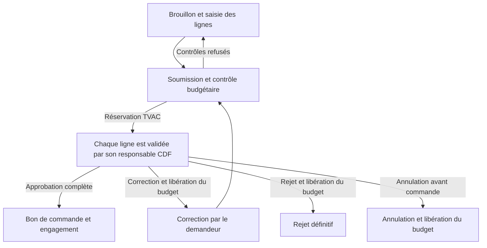

# BF ERP — Synthèse de l’application

**Dernière mise à jour : 12 novembre 2026.**

Ce document présente les fonctionnalités construites, les profils et les limites actuelles. Il sert de point d’entrée pour comprendre l’application. Les tests à effectuer sont décrits dans [le plan de recette](RECETTE_COMPLETE.md).

## 1. Objectif et état actuel

BF ERP est un projet d’ERP destiné à un organisme de formation du secteur public belge. Il vise à réunir progressivement la gestion des achats, des budgets et des autres activités décrites dans la spécification.

Le périmètre actuellement construit couvre la **demande d’achat jusqu’au bon de commande**, avec contrôle budgétaire, validation fixe par responsable CDF, gestion des acteurs et traçabilité. Les transferts budgétaires et les mouvements de stock disposent également de leurs parcours métier.

L’application est disponible pour la recette de ce périmètre. Les réceptions de commandes, factures, comptabilité et ventes restent à construire. Les applications vides `accounting` et `documents` ont été retirées du dépôt.

## 2. Parcours métier principal

La demande est soumise dans son ensemble. Chaque ligne exige une décision de son responsable CDF. La commande est créée lorsque toutes les lignes sont approuvées. Aucun circuit n’est à configurer ni à publier.

## 3. Profils et responsabilités

Ces profils sont des usages composés avec les rôles et permissions ; ce ne sont pas des comptes créés automatiquement. Un utilisateur peut cumuler plusieurs rôles.

| Profil | Possibilités principales |
|---|---|
| Administrateur système | Gérer comptes, rôles, droits, référentiels et responsables CDF ; suivre et réaffecter les étapes ; régler la déconnexion automatique |
| Budgétiste | Préparer et publier les budgets, consulter les disponibilités, créer BI et produits détaillés selon les droits attribués |
| Demandeur | Créer ses DA, modifier leurs lignes en brouillon ou correction, soumettre, annuler avant commande, consulter ses BC |
| Responsable CDF | Approuver, retourner pour correction ou rejeter les lignes de son CDF ; valider les transferts selon leur étape source ou destination |
| Délégué | Traiter temporairement les étapes au nom d’un titulaire, avec conservation de l’acteur réel |
| Responsable du suivi | Consulter les étapes, acteurs et blocages sans les données commerciales ou montants dans l’écran de suivi |
| Lecteur de toutes les DA | Consulter toutes les DA et leurs BC avec montants, sans modifier les demandes d’autrui |

Les droits de suivi, de réaffectation et de lecture financière sont distincts. Le statut administrateur ne dispense pas d’être éligible au titre du circuit métier pour approuver.

## 4. Fonctionnalités construites

### Comptes, rôles et sessions

- Création des comptes, activation/désactivation et permissions individuelles.
- Rôles ERP regroupant des permissions attribuables aux utilisateurs.
- Cumul des droits directs, des rôles et des éventuels groupes Django existants ; les groupes ne sont plus proposés dans l’interface courante.
- Retraits de droits pris en compte à la requête suivante.
- Permissions présentées en français dans les fiches des rôles et utilisateurs. Les droits de gestion budgétaire sont regroupés sous **Budgets** (`budgeting`) : enveloppes annuelles, versions, allocations, écritures et disponibilités. Les anciennes permissions budgétaires de `purchasing` et des tables Budget/BudgetLine ont été remplacées en conservant les attributions aux utilisateurs, rôles et groupes existants.
- Les droits des **produits budgétaires (BI)** restent sous **Budgets** ; ceux des **produits détaillés** sont sous **Achats** (`purchasing`), pour l’ajout, la modification, la consultation et la suppression. Leur rattachement à un BI reste inchangé et les attributions existantes sont conservées.
- Administration Django réservée aux comptes équipe disposant des permissions nécessaires ; les pages métier ne nécessitent pas ce statut.
- Déconnexion après **120 minutes d’inactivité par défaut**, pour tous les comptes, administrateurs compris.
- Durée réglable par un superutilisateur dans **Configuration → Déconnexion automatique**, de 1 à 10 080 minutes ; changements tracés.

L’activité de session correspond aux requêtes utilisateur : navigation ou enregistrement. Les mouvements de souris et une saisie non enregistrée ne prolongent pas la session. Le contrôle automatique de connexion ne la prolonge pas non plus. Les pages métier ouvertes vérifient périodiquement l’expiration ; le serveur refuse l’accès après expiration même sans JavaScript.

### Suppression des comptes et journal indépendant

Le superadministrateur peut supprimer un compte depuis la liste des utilisateurs ou sa fiche, même si ce compte a créé des demandes ou pris des décisions. Les demandes, commandes, engagements et preuves métier sont conservés ; les liens vers le compte supprimé sont détachés. Une affectation privée de son valideur reste à réaffecter et ne donne pas de nouveaux droits à d’autres comptes.

**Configuration → Journal des actions par utilisateur** donne accès à un journal sans clé étrangère vers les comptes ou les objets métier. Chaque entrée conserve date, identifiant et nom d’utilisateur au moment de l’action, type d’action, objet et détails. La suppression d’un compte ne supprime donc pas ses traces. Le filtre par utilisateur inclut les comptes supprimés ; cliquer sur l’en-tête utilisateur permet de trier. Un nouvel utilisateur reprenant le même nom reste distingué par son identifiant.

Le journal reprend les événements métier et les traces d’administration déjà enregistrés lors de la migration. Il enregistre ensuite les créations, modifications, suppressions et changements d’appartenance effectués via les modèles et interfaces applicatives instrumentés, ainsi que les événements métier explicites. Les mises à jour SQL directes ne sont pas un parcours audité. Les mots de passe et leurs empreintes ne sont pas copiés dans ce journal. Les traitements sans acteur utilisateur sont identifiés comme « Système ».

Le journal est réservé au superadministrateur et consultable sans modification ni suppression.

### Suppression de maintenance dans toutes les tables métier

Le superadministrateur dispose d’un lien **Supprimer** dans chaque liste des tables métier de l’administration, notamment les rôles, référentiels, budgets et données du flux achats. Les tables auparavant accessibles uniquement en lecture disposent aussi de cette action. Les anciennes configurations de validation restent conservées en base pour l’historique, sans éditeur ni liste d’administration.

La confirmation présente les enregistrements à supprimer, leurs dépendances obligatoires et les références facultatives à détacher. Une dépendance obligatoire est supprimée avec l’enregistrement ; une référence facultative est mise à vide. Les données et l’identité de l’acteur sont copiées dans le journal indépendant au sein de la même transaction. L’opération peut également être lancée sur plusieurs lignes sélectionnées.

Si une donnée supprimée participe à un cycle actif, celui-ci est arrêté, ses réservations sont libérées et la DA encore en validation revient en correction. Une règle privée de son rôle ou d’un critère de référence n’est plus applicable jusqu’à son remplacement ; elle ne devient pas une règle ouverte à tous. Les étapes privées de leur rôle n’acquièrent pas de nouveaux candidats.

La suppression de maintenance peut donc supprimer des données publiées et des données liées, selon le détail affiché avant confirmation. Elle est distincte des opérations métier habituelles et ne remplace pas l’annulation normale d’une DA. Les contrôles de publication et d’immutabilité restent applicables aux opérations ordinaires ; les contraintes de liens en base restent vérifiées. **Le journal indépendant est l’exception : il ne peut pas être supprimé.**

### Référentiels

L’application gère les fournisseurs, contacts et adresses, les centres CDF, supports, financements, produits budgétaires (BI) et produits détaillés rattachés à un BI.

Les BI et produits détaillés disposent de pages métier de création et de consultation soumises à permissions. Les autres référentiels se gèrent principalement dans l’administration technique.

Les responsables sont définis directement sur chaque CDF et support depuis l’écran de configuration ou l’administration. Les affectations sont revérifiées avant chaque décision. Les anciennes affectations datées restent uniquement en base pour préserver leur historique.

### Budgets

- Une enveloppe par année, plusieurs versions et une seule version active par enveloppe.
- Préparation en brouillon avec ajout, modification et suppression d’allocations avant publication.
- Allocations **TVAC par BI × CDF × financement** ; doublons et montants négatifs refusés.
- Publication/activation puis lecture seule par défaut. Un administrateur système peut débloquer les allocations pour modification, puis les rebloquer, sans retirer la publication ni changer la version active. Chaque opération est historisée.
- Maintien des réservations et engagements à travers les versions.
- Tableau des allocations, réservations, engagements et disponibilités.
- Consultation ponctuelle via **Vérifier un budget**, avec sélection d’une version active, remplacée ou brouillon.

**Disponible = allocation de la version considérée − réservations − engagements de l’enveloppe annuelle + solde des transferts de cette version.**

Une nouvelle version contient des montants totaux, pas des variations. La publication d’une version déficitaire est autorisée : le déficit reste visible, les nouvelles réservations sont bloquées, les réservations existantes peuvent être converties. Une combinaison retirée reste visible si elle porte encore des écritures ouvertes.

Les anciennes tables `Budget` et `BudgetLine` restent présentes pour l’historique ; elles ne pilotent pas le flux actuel et leurs compteurs ne sont pas repris automatiquement.

### Demandes d’achat

- Création d’une DA numérotée avec fournisseur et demandeur.
- Lignes avec produit détaillé, description, quantité, prix HTVA, TVA explicite, CDF et financement ; BI déduit du produit.
- Calculs décimaux des montants ; taux de TVA obligatoire, y compris à zéro.
- Modification réservée au demandeur en brouillon ou après correction.
- Contrôle budgétaire à la soumission, avec cumul des lignes d’une même combinaison.
- Soumission et réservation atomiques : une ligne bloquante ne laisse pas les autres partiellement réservées.
- Contrôle de révision contre l’écrasement d’une modification récente par un ancien formulaire.
- Historique des modifications et transitions.

### Validations fixes

- Demandes d’achat : une validation manuelle distincte par ligne, par un responsable actif du CDF de cette ligne.
- Transferts : validation par un responsable du CDF source, puis par un responsable du CDF destination.
- Deux décisions distinctes sont exigées pour un transfert, même si une personne gère les deux CDF.
- Sans responsable actif, l’étape reste « À affecter » ; aucune approbation automatique n’est effectuée.
- Les décisions et les anciens parcours déjà enregistrés sont conservés. Le moteur de règles et son éditeur sont retirés.

Les détails et les cas de recette actuels figurent dans [REGLES_VALIDATION.md](REGLES_VALIDATION.md).

### Corrections, rejets et annulations

| Action | Effet |
|---|---|
| Retour pour correction motivé | Arrêt de tout le cycle, libération de toutes les réservations, édition rendue au demandeur |
| Resoumission après correction | Nouvelle validation par responsable CDF pour chaque ligne, nouvelle réservation, ancien historique conservé |
| Rejet définitif motivé | Demande non modifiable et non resoumettable ; réservations libérées |
| Annulation par le demandeur avant commande | Arrêt du circuit et libération des réservations éventuelles |

### Délégations et réaffectations

Les délégations sont globales et limitées dans le temps. Le délégué agit au nom du titulaire ; l’acteur réel et l’utilisateur représenté restent traçables. Les droits métier du titulaire sont contrôlés à la décision. Les chaînes et délégations sortantes chevauchantes sont refusées.

Un utilisateur disposant du droit de réaffectation peut confier une étape accessible à un autre acteur éligible, avec justification, sans recommencer la DA ni créer de seconde réservation.

### Bons de commande

L’approbation complète produit un BC unique et convertit les réservations en engagements sans deuxième déduction du disponible. Le document s’ouvre dans le navigateur et peut être imprimé ou enregistré en PDF avec ses fonctions d’impression.

Les données du fournisseur et des lignes sont figées à la soumission : une modification ultérieure du référentiel ne réécrit pas le BC historique.

### Suivi et notifications

- File **Mes validations** et notifications internes.
- Suivi opérationnel filtrable par numéro et état : niveaux, acteurs, attente, étapes bloquées ou à affecter.
- Séparation entre suivi opérationnel et lecture financière.
- File durable de courriels, traitement par commande et gestion des tentatives.
- Messages obsolètes non expédiés ; échec d’envoi sans annulation d’une décision métier.

En recette locale, les courriels sont affichés en console. Le traitement des notifications actualise aussi les habilitations ; son exécution périodique doit être organisée pour fonctionner indépendamment des visites d’écrans.

## 5. Navigation

Les liens visibles dépendent des permissions.

| Rubrique | Écrans principaux |
|---|---|
| **Achats** | Mes demandes, Toutes les demandes, Produits détaillés, Suivi administrateur |
| **Budget** | Créer une version, Alimenter une version, Produits budgétaires, Budgets et disponibilités, Transferts, Historique budgétaire |
| **Stocks** | Dépôts, Quantités disponibles, Mouvements de stock |
| **Configuration** | Comptes et droits, Rôles ERP, administration technique, responsables CDF et supports, déconnexion automatique ; habilitations des anciens parcours |

Le bouton **Vérifier un budget** est accessible à tout utilisateur connecté.
**Mes validations** et **Mes délégations** sont accessibles dans l’en-tête personnel.

## 6. Limites actuelles

### Confidentialité financière

Le droit financier donne une lecture globale, sans restriction par périmètre. Le droit « Toutes les demandes » permet aussi de consulter les montants des DA et BC.

La consultation du tableau budgétaire relève du droit distinct `budgeting.view_budget_balances` (« Consulter les disponibilités budgétaires »). Un nouveau rôle budgétiste peut ainsi gérer les budgets et consulter leurs soldes sans obtenir la lecture financière globale des achats. La migration conserve les anciens accès au tableau en ajoutant ce droit aux comptes, rôles et groupes qui détenaient déjà le droit financier des achats ; elle ne retire pas leurs autres droits.

Le suivi opérationnel masque fournisseurs, descriptions commerciales et montants. Cependant, **tout utilisateur connecté peut consulter un disponible ponctuel via Vérifier un budget**, même sans accès au tableau global. Ces comportements doivent être pris en compte dans la validation des profils.

### Années et notifications

La soumission utilise l’année civile courante ; la clôture annuelle n’est pas implémentée.

Il n’existe pas de rappel fondé sur la seule ancienneté. La reprise automatique complète après échec permanent et l’alerte d’exploitation restent à compléter. La livraison SMTP exactement une fois n’est pas garantie après arrêt entre envoi et confirmation en base.

### Validation et exploitation

SQLite permet la recette locale des parcours. Les garanties de concurrence et protections SQL de l’historique nécessitent PostgreSQL et les tests dédiés. Le durcissement d’exploitation reste à traiter avant mise en production.

L’existence de tests automatisés et d’un plan de recette ne signifie pas que la recette métier a été acceptée. Les résultats et anomalies doivent être consignés séparément.

## 7. Fonctionnalités restant à construire ou finaliser

| Domaine | Éléments restants |
|---|---|
| Après commande | Annulation de BC, régularisations d’engagement, avenants TVA, ajustements approuvés |
| Réceptions et factures | Parcours de réception, factures fournisseurs et rapprochements |
| Budgets | Alertes automatiques de déficit BUD-019/020/021 ; clôture annuelle |
| Suivi et notifications | Archivage des notifications informatives, reprise et alertes d’exploitation |
| Autorisations | Restriction de la consultation financière par périmètre à cadrer |
| Autres domaines ERP | Comptabilité complète, paiements, immobilisations, ventes et facturation clients selon les règles restant à spécifier |
| Déploiement | Durcissement, traitements périodiques, intégrations et migration des données selon le cadrage retenu |

Cette liste ne fixe pas un ordre de développement ni de décisions métier nouvelles.

## 8. Documents de référence

| Document | Utilité |
|---|---|
| **Cette synthèse** | Comprendre le produit construit, les profils et les limites |
| [RECETTE_COMPLETE.md](RECETTE_COMPLETE.md) | Tester depuis une base vierge et consigner les résultats |
| [SPEC_ERP_CODEX_V0_1.md](../SPEC_ERP_CODEX_V0_1.md) | Exigences et périmètre cible, y compris les éléments non livrés |
| [ARCHITECTURE_ERP_V0_1.md](ARCHITECTURE_ERP_V0_1.md) | Analyse technique et plan historique ; certains constats décrivent l’état initial |
| [LOT_0B.md](LOT_0B.md) | Bilan historique de cet incrément |
| [RECETTE_ACHATS.md](RECETTE_ACHATS.md) | Indications historiques de démonstration et de démarrage |

Mettre à jour cette synthèse lors de chaque évolution fonctionnelle significative : livraison, changement de droits, nouvelle limite ou extension du périmètre.
